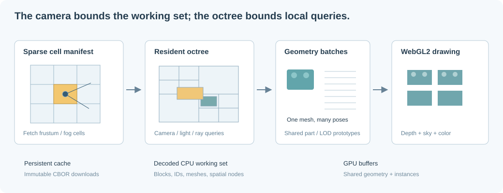

# 3D indexing for efficient display

## Goal: make frame cost depend on what is resident

A construction may contain far more bricks than the browser can draw or hold in
memory. The renderer should never need to enumerate the entire world every frame.
There are two distinct questions:

1. Which persisted blocks should be resident near the camera?
2. Which resident objects participate in a draw, pick, or proximity query?



The client selects manifest cells intersecting the camera frustum and finite fog
range, then builds a resident octree. The tree prunes individual draw candidates;
geometry is batched by part and detail level. Display residency, render LOD, and
the complete working set required by physics are separate concerns.

## One block-oriented engine, three entry points

The navigator, homepage and MCP captures use one scene-planning and WebGL2
pipeline. Entry points select explicit quality/visibility policies, camera/input
and lighting parameters; background transparency does not select geometry policy.

- `crates/client/src/scene/view.rs` owns physical-scale projection, floating origin,
  frusta and pick-ray unprojection, shared by drawing, streaming and picking.
- `scene.rs` produces deterministic part/LOD batches and **separate camera and
  light-space instance lists** from the resident octree.
- `scene/surfaces.rs` caches greedy, material-preserving exterior meshes of distant
  upright standard-body chunks, independently of authoritative/picking geometry.
- `scene/ground.rs` produces bounded baseplate/stud instances without a browser/GPU
  dependency. The same CPU planner is usable in native regression tests.
- `renderer/batches.rs` owns immutable prototype buffers, per-pass instance buffers,
  draw submission and resource release. Replacing a prototype invalidates its
  derived LOD/GPU entries; unchanged prototypes survive streaming updates.
- `renderer/illumination.rs` prepares the light, then renders depth from the
  independent caster list. `renderer/shaders.rs` supplies shared block deformation
  and material code. Stud thresholds are generated from the Rust detail constants.
- `renderer.rs` orchestrates planning, upload, depth, sky and opaque-color passes.
  Preview, navigator and MCP wrappers do not implement alternative draw backends.

This adopts game-engine ideas of shared prototypes, data-oriented instance batches,
hierarchical visibility, explicit passes, change-driven uploads and LOD hysteresis;
see [instancing references](references.md#s5-engine-style-instancing-and-pass-reuse).
Blocks make prototype reuse unusually effective: palette colors/transforms are
instance attributes, not separate copies of a part's vertices. Render chunks are
derived from residency, not mechanical assembly boundaries or S3 file boundaries.
This is a small ordered pass pipeline. Its hierarchy, quality policies and buffer
reuse are implemented in the modules above.

Interactive views use adaptive detail and camera culling. MCP captures retain
full source geometry for camera-visible pieces. The tiny homepage illustration
keeps every color instance at full detail. All use light-volume culling for
resident shadow casters; camera clipping no longer removes an offscreen caster.

## Frustum- and fog-bounded streaming

For camera position $\mathbf{c}$ and block side $B=1024$:

$$
\mathbf{k}_c=\left\lfloor\frac{\mathbf{c}}{B}\right\rfloor.
$$

Let $F$ be the view frustum and $d_f$ the fog cutoff. The desired persisted set is:

$$
\mathcal{R}=\{\mathbf{k}:B_{\mathbf{k}}\cap F\ne\varnothing,
\quad \operatorname{dist}(\mathbf{c},B_{\mathbf{k}})\le d_f\}.
$$

Only existing construction cells in this set are fetched, with four concurrent
block requests. The ground layer independently creates missing **visible**
horizontal cells lazily, each with one imagery-derived palette color. There is no
infinite-world pre-generation; see [ground and coordinates](ground-and-coordinates.md).

Fog starts at $0.65d_f$ and reaches the background color at $d_f$. The default
cutoff is 2,200 stud-scaled render units; the UI range is 200–4,096. Residency is
bounded to 128 construction blocks and 200,000 references. If the desired set
exceeds those bounds, the client shortens its effective fog distance instead of
silently omitting cells inside that distance. A single dense cell can still need
smaller render pages; an explicit budget failure is reported in that case.

Requests carry a world-generation check, and late results outside the current
view are discarded from memory. The current sparse manifest is scanned to select
candidate storage cells.

## Boundary-crossing bricks

A brick is not cut at cell boundaries. Partitioning inserts a reference into
every cell intersected by its **render bounds**, including studs. The client
deduplicates by brick ID before drawing and indexing. Using only the origin cell
would make a brick disappear while its geometry is still visible from a neighbor.

Replication is limited to 64 cells per brick. For very large spanning structures,
use a separate oversized-object index rather than unbounded replication.

Display bounds include every rendered vertex. Physics body bounds intentionally
exclude decorative studs for catalog parts. Reusing either bound indiscriminately
would introduce a correctness bug in the other subsystem.

## Octree organization

An octree recursively subdivides a cube into eight children. Each brick's AABB is
stored in the smallest node whose volume fully contains it. A brick crossing a
split stays in its parent; it is not duplicated across all eight child nodes.

For a query box $Q$, traversal skips any node $N$ satisfying:

$$
N_{\max,x}<Q_{\min,x}\quad\lor\quad N_{\min,x}>Q_{\max,x}
$$

or the analogous condition on Y or Z. Parent-held objects must still be tested
when visiting a node. Omitting them loses large objects crossing split planes.

The implementation uses a leaf target of 24 objects and maximum depth 16.
Average local query work is often close to $O(\log N+K)$ for well-distributed
objects and $K$ results, but this is **not a worst-case guarantee**. A large number
of objects spanning the same split plane can cause $O(N)$ traversal.

Currently a bounded resident octree is rebuilt after loading/eviction or a pose
update. For larger resident sets, build independent per-block/page trees, reuse
unchanged trees, and keep a small top-level index over those pages. Physics should
use its own temporally coherent broad phase, not rebuild the display tree at
every solver substep.

## Implemented frustum culling

A frustum consists of six half-spaces. For inward plane normal $\mathbf{n}$,
offset $d$, AABB center $\mathbf{a}$, and half-extents $\mathbf{h}$, the box is
outside when:

$$
\mathbf{n}\cdot\mathbf{a}+d+
|n_x|h_x+|n_y|h_y+|n_z|h_z<0.
$$

This test is applied to octree nodes and their parent-held objects before mesh
instances are assembled. A radial fog-range test removes additional candidates.
Camera, viewport, pose, or fog changes invalidate the instance lists.

## Progressive distance detail

Approximate a part's projected diameter by:

$$
s_{px}\approx\frac{H\,D}{2d\tan(\theta_v/2)},
$$

where $H$ is viewport height, $D$ the metric-proportioned bound diameter, $d$ camera
distance, and $\theta_v$ vertical field of view. The implemented discrete tiers are:

- At least 24 px: detailed supplied/cached Ergo geometry.
- At least 8 px: simplified parametric mesh for known rectangular catalog parts,
  or a reviewed specialty display mesh.
- At least 2 px: nominal rectangular body box, or the specialty's far mesh.
- Below 2 px: coarse colored bounds aggregated in 8-unit spatial buckets.

The listed thresholds initialize a piece's tier. Subsequent changes use a **12%
hysteresis band**: refine above 1.12× a boundary and coarsen below 0.88× it.
Large camera moves can cross several tiers in one update. Unreviewed nonrectangular/custom
parts retain their canonical mesh through the medium tiers, rather than
substituting a box that changes their silhouette; subpixel aggregates still apply.
The selected piece keeps detailed geometry; highlighted group members retain at
least box-level individual display. Full resident geometry remains available for
picking, and physics never substitutes these render LODs for its body model.
Fog hides the final distance cutoff. A scene-wide detail bias can move a part
between the first three tiers, but aggregation still requires its **unbiased**
projected size to be subpixel-scale. Merging resolvable façade/window pieces into
colored envelopes would create overlapping bounds and damage the architecture.

### Scene-wide budget and quality controls

The navigator's **Render detail** control selects an explicit policy:

- **Auto (balanced)** targets 2,000,000 estimated brick triangles **per pass**.
- **Performance** targets 500,000 per pass.
- **High (per-brick LOD)** retains the original per-brick thresholds without a
  scene-wide target, and uses full source meshes for resident shadow casters.

For budgeted modes, the planner counts the cost of all camera-visible candidates
at a common projected-size divisor of 1, 2, 4 or 8. It coarsens until the estimate
fits or reaches 8, then refines only with 25% spare budget. The per-piece 12%
hysteresis still applies. This is a fixed **soft triangle target**, not a frame-time
controller or a guaranteed cap. Source-only/custom silhouettes, selected pieces,
individual highlighted pieces and the stud transition can keep it above target.
Ground is outside these targets. Greedy surfaces use their actual triangle cost;
subpixel bounding aggregates conservatively count each candidate before merging.
Picking, collision, resident piece count and saved
models retain their full geometry. Captures and the homepage illustration keep
their full-detail policies independently of the navigator control.

Shadow LOD uses the light buffer's projected stud size, rather than the color
camera's distance: source mesh at 6 texels or more, reviewed medium mesh from
1.25 texels, otherwise a reviewed far mesh, with 12% hysteresis. Its own 1/2/4/8
detail divisor can coarsen that projected size to meet the separate pass target.
Source-only, selected
and highlighted pieces remain source geometry. The independent light-frustum
query still includes resident offscreen casters. Its instance plan is cached
until the light matrix/origin/resolution, scene/meshes, selection, explosion or
policy changes. Camera-only color replans can reuse it; the existing GPU depth-map
reuse remains separate. The shadow target is soft too: protected source geometry
may exceed it. This matters especially at night, when a moving camera headlamp
changes the shadow matrix on every view update.
The [display part library](part-catalog.md#reviewed-display-detail-library) adds
open-aperture window frames 60594/60592, annular round brick 87081 and verified
parametric aliases; these specialties do not turn into solid body boxes. Its
eight-sided standard studs also reduce the cost of medium and shadow detail.

### Cached greedy surfaces: hidden faces and coplanar merging

For static resident regions of at least **10,000 pieces**, budgeted policies can
replace far standard rectangular bodies with derived chunk meshes:

1. Group upright, axis-aligned, reviewed standard bodies by the 32-unit cell
   containing each body's center. Quantize only bodies already aligned within
   1e-5 grid units to the existing **1-stud × 1-plate × 1-stud** grid.
2. Fill a temporary material grid. Reject ambiguous overlaps or oversized chunks;
   ineligible pieces retain their ordinary individual LODs.
3. Remove faces between occupied cells, including internal material boundaries.
   Greedily combine adjacent exposed coplanar cells of the **same RGB material**
   into rectangles. Emit two triangles per rectangle. Air apertures stay open;
   unlike coarse bounding envelopes, this does not fill gaps between bodies.
4. Keep a derived mesh only when it beats the individual boxes. A chunk's grid is
   bounded to 1,048,576 cells; retained derived vertex bytes total at most 64 MiB.
   These are logical buffers, not a complete allocator/GPU-memory quota.

The meshes are built once per scene/mesh edit and shared by color/depth passes.
Neither camera motion nor quality tier changes rebuild their vertices. Chunk-level
culling/detail tests run before individual candidate/matrix generation, avoiding
tens of thousands of per-brick allocations, projections and instance uploads.
The render planner's part-cache hits also avoid allocating a temporary part-ID
string for each piece.

Auto uses a conservative fixed chunk-detail divisor of 4; Performance uses 8.
Color chunks require their largest member's projected size divided by that value
to be below 8×0.88 px, and the **actual** projected stud diameter below 1.25×0.88 px.
Shadow chunks use the light-buffer stud diameter divided by the same value.
These chunk guards are separate from the remaining per-brick adaptive budgets.
The chunk bounds include all members, so culling may submit offscreen members
of an intersecting chunk; the GPU still clips them. LOD piece counters therefore
report represented members, not an exact count of individually visible bricks.

Selecting/highlighting a member restores individual rendering for that chunk.
Explosion, High, captures and the homepage bypass merged surfaces. Pose/color or
prototype changes invalidate both derived CPU meshes and their GPU buffers.
Specialty/custom shapes remain separate; source vertices/IDs, authoring exports,
triangle picking and walking/physics bodies are not replaced. This is an exterior
LOD of the existing body proxies, not an exact hollow-solid reconstruction.
The 10,000-piece threshold also excludes the bounded 5,000-body dynamic simulator.

### Idle rendering

The navigator reuses its composited canvas while geometry, camera, viewport and
lighting are unchanged. It no longer continuously submits the same large color
pass at rest. Input/material controls mark the renderer dirty; solar updates and
capture requests still redraw. Shadow-map caching is independent. The static
preview's point/studio-light path and full-detail capture policies remain explicit.
`data-rendered-frames` counts actual draws; callback/FPS labels are not GPU timers.

### Measurements and repeatable profiling

The 2026-10-28 comparison uses the **actual shared-view packet**, revision
`a569bdf47ce1dac69528a7be04161e7ab37677e4e078f857a257d289ab41ead5`,
with **91,265 pieces**. This preserves the live prototype names and frozen source
variants. The earlier combined construction readback normalized aliases differently
and understated the live cost: 26,413 source brick/plate instances were still at
full detail. Reviewed whole-vertex fingerprints now recognize those variants.

On an Apple M4 Max/ANGLE Metal backend in actual headless Chrome WebGL2, at
1440×1000/device scale 1, the same warmed **night-time UI orbit** changed from
**83.3 ms median presentation intervals (about 12 FPS) to 16.7 ms (about 60 FPS)**.
P95 intervals also changed from 83.4 to 16.7 ms in that run. Auto's fitted-frame
color triangles fell from **17,759,210 to 1,611,344 (91%)** and planned brick-shadow
triangles from **42,116,294 to 944,676 (98%)**. 86,346 bodies were represented by
cached surfaces. Performance submitted 654,336 color / 654,324 shadow triangles
and also reached the presentation limit; its protected-geometry floor remained
above its 500,000 target. All original piece records remain resident. These are
local scenario measurements, not portable FPS or latency guarantees.

The native 1280×720 planner ablation separates the effects, on the same packet:
with reviewed aliases and per-pass budgets but **no merging**, near color/depth
work was 1,979,926 / 1,497,550 triangles and a warm plan took 30.7 ms. Enabling
cached surfaces gave **1,398,604 / 986,668 triangles**, 26,968 color instances
instead of 91,183, and **7.2 ms** warm planning. At three times the distance it
used 514,922 color triangles and 1.5 ms warm planning. Cold surface construction
plus first planning took roughly 87–96 ms in these native cases. Native timings
are CPU-only and do not measure browser/GPU frame time; the cameras/light volumes
differ from the browser measurement above.

After building the viewer WASM and local server, with Playwright/Chrome installed:

```sh
cargo run --release -p ergo-client --example profile_scene -- construction.ergo.json
cargo run --release -p ergo-client --example profile_scene -- --inventory construction.ergo.json
python3 scripts/profile-rendering.py construction.ergo.json --output target/render-profile.json
# Preserve the original live aliases in a captured shared-view JSON packet:
cargo run --release -p ergo-client --example profile_scene -- --view-packet view.json
python3 scripts/profile-rendering.py view.json --view-packet --night --qualities auto performance --output target/live-render-profile.json
```

The native example uses the actual scene planner without a GPU. The browser
script uses disposable local storage and a read-only scene-response fixture,
because combined accepted readbacks can contain prototype aliases that the
public authoring importer intentionally rejects. It runs the actual WASM/WebGL
renderer, primes the selected policies, then drives UI pointer orbit, writes
per-mode PNGs and reports canvas metrics/presentation intervals. It never saves
or publishes the preview. The JSON records the actual graphics backend and GL
errors; `--qualities` selects the policies to exercise. `--view-packet` reads a
captured JSON view packet without rebuilding/renaming its prototypes; `--night`
exercises moving headlamp shadows rather than only a scene-fixed daylight map.
Only one measured browser should render during a comparison. Browser checks also
verify idle draw suppression and explicit grid-control redraw.

Canvas diagnostics include `data-color-triangles` (submitted color geometry,
including ground), `data-brick-shadow-triangles-estimate` (resident brick casters,
not necessarily redrawn that frame), `data-detail-scale`, `data-lod-counts`,
`data-shadow-lod-counts` and `data-color-budget-estimate-exceeded`. The last flag
describes the conservative brick estimate, not a GPU timeout or a world limit.
`data-shadow-detail-scale` and `data-shadow-budget-estimate-exceeded` cover the
remaining per-brick shadow budget. `data-surface-pieces` reports members represented
by color chunks; `data-scene-plan-ms` reports the last CPU plan only, not draw/GPU
time. `data-frame-redrawn` and `data-rendered-frames` distinguish actual rendering
from idle timer callbacks.

### Relation to Nanite

[Unreal Engine's Nanite](https://dev.epicgames.com/documentation/en-us/unreal-engine/nanite-virtualized-geometry-in-unreal-engine)
builds a hierarchical multiresolution representation of triangle clusters, selects
detail according to projected error, culls visibility on the GPU and streams
compressed geometry pages as needed. That makes the selected work depend on the
visible image rather than submitting every source triangle in a huge scene.

Ergo implements the smaller WebGL2-compatible steps above: shared part prototypes,
resident-octree culling, cached greedy body-surface chunks, per-pass screen-detail
budgets, light-space LOD and pass reuse. It does **not** implement Nanite triangle
cluster hierarchies, GPU occlusion culling,
error-bounded arbitrary-mesh simplification or virtualized geometry streaming.
General building/arbitrary-mesh hierarchies and finer-grained source-mesh clusters
remain future extensions; coarse-first loading would need revision-bound summaries
while preserving real geometry for editing and collisions.

### Rendering detail versus loading detail

These tiers reduce drawing work after the region is resident. They do not avoid
reading all region piece records or downloading their source mesh prototypes.
Current shared-region loading still prepares a complete bounded region; nearby
camera-cell cache reuse can skip an unchanged rebuild, but is not coarse-first
streaming.

Construction-level coarse-first loading is a future extension, not an implemented
guarantee: it needs cheap, revision-bound construction/cell summaries or coarse
meshes, followed by full geometry only near the camera or on demand. Such visual
proxies must not be treated as complete editable or collision/physics geometry;
walking into an unloaded area must wait for its real collision data. Lowering GPU
detail alone cannot solve the measured per-record S3 traversal bottleneck.

## Picking: broad phase, then triangle tests

The mouse position is unprojected through the inverse view-projection matrix to
form a world-space ray. A slab intersection finds candidate AABBs. For axis $a$:

$$
t_a^- = \min\left(\frac{b_a^- - o_a}{d_a},\frac{b_a^+ - o_a}{d_a}\right),
\qquad
t_a^+ = \max\left(\frac{b_a^- - o_a}{d_a},\frac{b_a^+ - o_a}{d_a}\right).
$$

Intersect the three intervals. Handle $d_a=0$ explicitly: division by zero at a
box boundary otherwise produces NaNs. Candidates are sorted front-to-back, and
testing stops once the next box cannot beat the closest hit.

For brick transform $A$ and position $\mathbf{p}$, test its shared mesh using:

$$
\mathbf{o}_{local}=A^{-1}(\mathbf{o}-\mathbf{p}),\qquad
\mathbf{d}_{local}=A^{-1}\mathbf{d}.
$$

Do not normalize the transformed direction when comparing the resulting ray
parameter across differently scaled parts. Exact mesh picking can coexist with
approximate box-based physics.

## One geometry, many instances

Repeating the same brick mesh for every brick wastes both transfer bandwidth and
GPU memory. A geometry batch stores vertices once and supplies each instance's
transform, color, and selection state through instanced attributes.

For $N$ bricks, $P$ unique part meshes, $V_p$ vertices in part $p$, and $I$ bytes
per instance:

$$
M_{GPU}\approx\sum_{p=1}^{P}V_p\,s_{vertex}+(N_{color}+N_{shadow})I.
$$

The current layout uses 36 bytes per vertex and 80 bytes per instance per pass.
Color and depth VAOs share the same prototype vertex buffer. A batch uploads its
instance array only when its contents change; orbiting the complete static
homepage scene needs no geometry/instance re-upload. Retained CPU copies allow
these comparisons and are separate from the GPU-byte counter. Draw-call
count follows the number of visible part/LOD batches, aggregates, and ground draws.
This is why increasing the number of brick instances is often cheaper than
increasing the number of unique geometries or materials.

The initial palette is opaque. Adding transparent colors requires ordering or a
dedicated transparency algorithm; simply enabling blending within an arbitrary
instance batch is insufficient.

## Floating origin and numerical precision

Global coordinates are float64 on the CPU. GPU transforms are float32. At a world
coordinate of magnitude $10^9$, float32 no longer resolves single-brick details.
Before uploading positions, subtract a nearby block-aligned origin:

$$
\mathbf{o}_r=B\left\lfloor\frac{\mathbf{c}_{target}}B\right\rfloor,
\qquad
\mathbf{p}_{GPU}=\operatorname{float32}(\mathbf{p}_{world}-\mathbf{o}_r).
$$

The camera uses the same origin. Rebase instance buffers when the target enters
a new origin cell without modifying persisted coordinates.

## Three different caches

- **Persistent browser cache:** immutable CBOR responses, keyed by their
  world-authorized URL containing a SHA-256 object hash. The service worker uses
  a 128 MiB / 512-response budget and insertion-order eviction. This is FIFO,
  not a claimed full LRU implementation.
- **CPU cache:** nearby decoded blocks, deduplicated brick records, shared meshes,
  and the resident octree. A raw CBOR byte count understates decoded memory.
- **GPU cache:** shared mesh buffers and instance buffers for the current scene.
  A prototype is released when neither pass references it, when replaced, or when
  switching worlds. The shadow depth texture/driver overhead is additional memory.

Content-addressed objects never need in-place invalidation. New content gets a
new hash; manifests select a new set of hashes. The current service worker does
not cache sessions, world lists, manifests, or the app shell and does not promise
full offline operation. Logout clears model caches.

Shared-region URLs use a separate, permission-revalidated path: typed CBOR/gzip,
server revision-keyed encoded/persistent read caches, and ordinary HTTP ETags.
They are not added to the service-worker immutable-object cache. The viewer's
separate content-addressed IndexedDB cache retains construction/index bytes only for use
after a fresh authorized HTTP 304. Region refreshes
retain unchanged GPU prototypes, and selecting a snapshot-certified fully
resident assembly focuses it without a location/view fetch. See
[loading and caching](loading-and-cache.md) for limits and invalidation.
