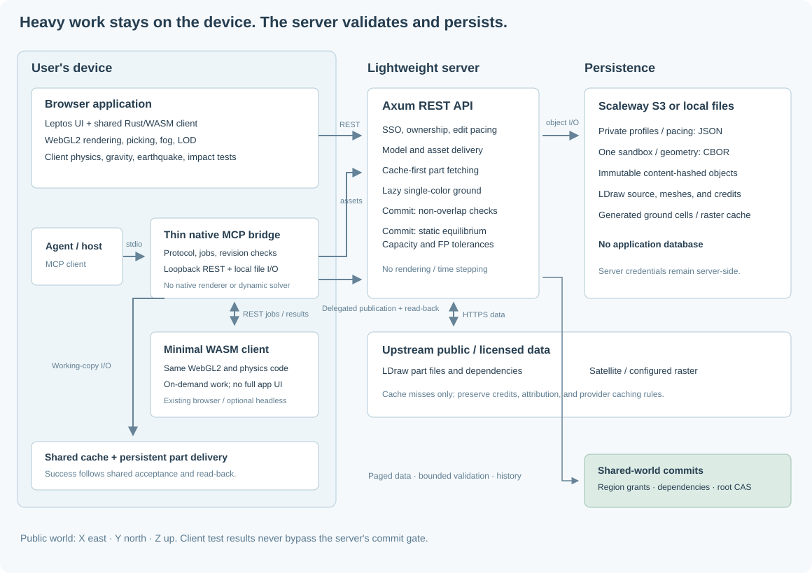

# Architecture and execution boundaries

Ergo has one hosted public Sandbox. Authenticated accepted edits share the same
S3-backed world. The browser list visits constructions at their real positions;
it does not open alternate worlds.

## Client engine

Three entry points use the same Rust/WASM WebGL2 implementation:

- The Leptos browser workbench streams bounded shared regions, supports orbit/fly/
  walk navigation, displays live GPS and maintains private placement context.
- A minimal HTML/WASM MCP client performs local editing, simulation and actual
  image capture. It mounts no full workbench and stays idle between jobs.
- The public homepage supplies a small illustration/input adapter with explicit
  full-detail and cursor-light parameters.

`crates/client/src/scene.rs` and `scene/{view,ground}.rs` plan native block instances,
camera/light visibility, projected detail and ground. `renderer/batches.rs` shares
prototype buffers between separate color/depth lists and skips unchanged uploads.
Lighting, sky, shadows and material code are shared. See the
[display pipeline](3d-display-indexing.md) and [lighting](lighting.md).

Rapier integration and all time-stepped probes run in the local WASM client.
Physics uses a complete mechanical working set; turning the camera cannot remove
a support from the simulation. Render LOD is not a physics-body model.

## Native model and asset boundary

Construction files are `ergo-construction-1`; reusable definitions are
`ergo-model-1`, with typed targets and public native transforms. Import adapters
convert external documents before these descriptions are stored. Catalog assets
are `ergo-part-1` plus Ergo geometry. Native readers accept the current versions
only. See [formats](construction-format.md) and [parts](part-catalog.md).

## Thin native MCP bridge

`crates/mcp/src/main.rs` owns stdio/schema handling, a capability-protected loopback
job API, private cache files, part I/O and authenticated remote requests. A single
continuously driven Tokio runtime serves browser jobs while stdio waits.

Native remote handlers open shared constructions, read allowance/last-position
context and publish validated edits. They do not render or run rigid-body dynamics.
Browser jobs return actual WebGL PNGs, not generated concept illustrations.
Publication credentials remain in the native process, outside local WASM.

## Server

The Axum service performs I/O, authentication, normalization, bounded dependency
discovery, static acceptance and conditional publication. It runs no dynamic
simulation or rendering. Important routes include:

- `/api/config`, `/api/catalog`, `/api/parts/{part}`, `/api/ground/{x}/{y}`.
- `/api/import`: convert an uploaded model to an Ergo preview.
- `/api/shared-worlds` and `/api/shared-worlds/{id}`: the one hosted world/head.
- Assembly lists and bounded `/location`, `/workspace`, rules and piece APIs.
- `/view`, block pages, accepted history, events, grants and retention controls.
- `/api/user-position`: private own-user last camera/target context.
- `/api/auth/me`, `/api/auth/mcp-token`, `/api/auth/logout` and Google callbacks.

Private account records, native caches and the authoritative world have separate
[S3 namespaces](object-store-layout.md). The reusable transaction library owns
immutable CBOR, read/predicate validation, durable maintenance pins and head CAS.
The service supplies authenticated authors and schema-linked retention tracing.
Shared-region loading uses typed CBOR/gzip and discardable revision-keyed encoded
read packets. Current authorization is checked before cached responses or 304s;
authoritative validation never consumes these packets. See
[loading and caching](loading-and-cache.md).

## Acceptance

The server normalizes client geometry claims with its frozen physical data,
rejects overlap/floor crossings, and validates the complete affected old/new
contact/constraint/group domain. Loose bodies use nonnegative compression load
flow; constrained bodies require a valid wrench assignment and measured joint
capacities. Oversized domains are rejected, never silently truncated.

Audit and model/policy links publish with the accepted head. An uncertain write is
fenced and not blindly retried. See [validation](validation-gates.md),
[shared protocol](concurrent-global-editing.md) and [transactions](transactional-storage.md).

## Build boundaries

`cargo xtask build-web` separately compiles the workbench and minimal MCP WASM
entry points and generates bindings. `cargo xtask build-site` compiles the same
engine for the public guide. Ordinary native server builds need no WASM toolchain;
prebuilt MCP consumers need no Rust. Release packaging combines native binaries
and matching WASM assets with version/checksum guards.
