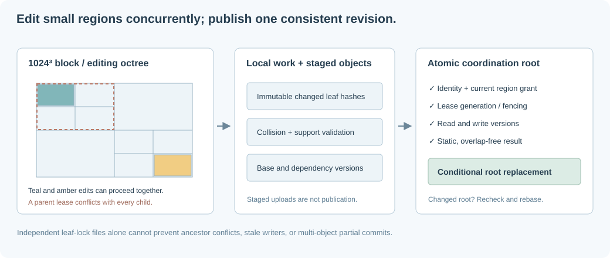

# Concurrent editing of the global shared model

## Implemented scope

`crates/server/src/shared/` integrates `ergo-transactions` with authenticated REST
requests, explicit region grants, stable content-derived identities, spatial
paging, immutable audit records, and server-owned static validation. Coordination
is **optimistic**, without region leases. Private `/api/worlds` snapshots and the
local MCP working copy are separate workflows. The browser UI and MCP tools do
not yet expose shared-world authoring controls.

**There is no aggregate world-size, piece-count, or block-reference limit.** A
world may grow to the capacity of its object store. No head contains a flat list
of its geometry, and no normal route exports or scans its complete geometry.
Limits apply to each request's working set, not to persistent world cardinality.



## Object model and stable identity

Each world has a separate namespace and a `main` head. Root octants select:

- `0`: versioned owner/region-grant policy.
- `1`: adaptive block-local spatial-reference octrees under signed block addresses.
- `2`: small immutable world metadata: name, geographic origin, frozen model CID.
- `3`: authoritative piece records, indexed by full SHA-256 piece IDs.
- `4`: paged authoring-assembly headers, membership, adjacency, and rule rows.
- `5`: allocated-block directory, addressed by the signed block octree.
- `6`: explicit global joint records; `7`: per-piece incident-joint directories.

Packed unary edges avoid allocating a storage object for each bit-group in a
64-level coordinate or 256-bit content ID. A spatial block contains **references**
to pieces, not independent copies of their geometry. Each piece record selects
its pose, immutable mesh CID, assembly, assembly-local authoring number, and
complete set of spatial replicas. Its current content hash is its version.

The stable piece ID is SHA-256 of an immutable `Birth` record containing:

- An instance nonce and verified creating actor.
- Its authoring assembly ID.
- Initial geometry/pose values and initial mesh CID.

The creation record is an explicit immutable commit attachment. Identical assets
share mesh content; their instances retain distinct birth identities. Editing a
piece preserves its ID and replaces its content-addressed version. Deleting and
recreating a similar piece creates a new identity. IDs are full hashes, not
truncated UUIDs or a world-wide `u32` sequence.

Assemblies package a bounded import's meshes and paged local-to-global rule
references. Their local integers do not limit world cardinality. Temporary physics
IDs are allocated only after loading a validation domain. Imported rules/groups
remain assembly-scoped, while the explicit joint API connects global piece IDs
across assemblies. Incident directories join both endpoints into validation.
See [storage operations](storage-operations.md) for layouts, paging, and migrations.

## Permissions and atomic publication

Creating a world makes the authenticated creator its owner. Existing-world access
requires ownership or an explicit grant. A grant names a user and octree prefixes
relative to the signed block-coordinate tree. A grant permits reading that world
and writing covered blocks; it is not regional data secrecy.

Only the owner changes grants. Google authentication alone grants no editing
authority in another user's world. All writes use the existing signed session,
same-origin checks, and `X-Ergo-Request: 1` header. Development mode uses the
explicit development identity, rather than inventing a Google role.

Every edit reads the policy through its transaction. Before changing a piece, the
server checks all original and destination replica cells. Rule edits check the
referenced pieces' footprints. The server computes these footprints from trusted
mesh data and poses; clients do not submit authoritative bounds or replica lists.

Policy changes and geometry share the same root CAS. A concurrent revocation
invalidates a prepared transaction's policy read. There is no separate
check-policy-then-unconditional-write window. Stage uploads precede publication;
a failed validation or upload cannot publish partial geometry or references.

## On-demand complete dependency domains

The server does not load a whole world to discover an edit's dependencies:

1. Open the accepted base revision and read its policy, small metadata, and frozen
   physics model. Load the explicitly edited piece records and relevant assembly
   rule records.
2. Discover the **old** closure by following explicit constraints, authoring-group
   relationships, and spatially touching body boxes. Spatial queries traverse only
   covered octree prefixes and paged block records. Load candidate identities and
   meshes within the operation budget; use an in-memory octree per loaded block.
3. Stage piece changes and atomically maintain their authoritative records and
   all original/destination block references. Update assembly-local mappings for
   deletion and validate changed rule references.
4. Observe a conservative swept footprint. Rediscover the **new** closure, starting
   with both old-domain and edited identities. Removing a support cannot omit its
   formerly supported neighbors simply because they are now disconnected.
5. Remap the complete affected set to temporary integer IDs, infer automatic
   connectors, apply the frozen server-owned measurement book, and run the static
   overlap/support/wrench certificate. The server runs no dynamics.
6. Attach an immutable audit/certificate and publish by conditional root update.
   Disjoint dependencies can rebase automatically; changed dependencies produce
   HTTP 409 and require recomputation against a fresh accepted base.

The neighbor halo is the larger of the static position tolerance and the
`INFERRED_JOINT_HALO` used by connector inference. Stored render bounds include
nominal body bounds, so an intersecting body cannot hide outside its indexed
replicas. The swept sphere covers translation and rotation about the piece origin;
it registers dependencies, **not** a continuous-path collision-clearance claim.

Spatial scans protect against phantom insertions and missing neighbors. Loading
candidate piece versions protects against an existing block member moving into
the neighborhood without changing block membership. Cross-assembly contacts and
long support chains are followed until the closure is complete or the operation
budget is exceeded. No unloaded support is silently treated as empty space.

### Working-set limits, never world limits

Defaults are 5,000 loaded/candidate identities and 128 MiB of charged CBOR data per
edit. Configure `ERGO_SHARED_WORKING_PIECES` and `ERGO_SHARED_WORKING_BYTES` to
change these operation budgets. Oversized closures return HTTP 413 before
publication. Imports are bounded batches; arbitrarily many separate assemblies
can coexist in a world whose total size exceeds those budgets.

The byte budget covers application CBOR, not a complete allocator RSS bound.
Index nodes, decoded structures, and serialization buffers have their own
overhead. Adaptive local spatial pages select bounding references before loading
piece geometry, and ordinary edits read per-piece rule rows. Whole-rule replacements
remain bounded authoring operations. Legacy records use their bounded compatibility
path until upgraded. There is no global counter coupling unrelated imports.

### Frozen physical model

At world creation, the server captures its measurement book, tolerances, and
algorithm version in an immutable model object. That CID is in world metadata and
every audit. Edits use this frozen version, so another deployment's environment
cannot silently reinterpret unloaded regions under different assumptions.
Model migration/versioned boundary certificates are future work, not an implicit
whole-world revalidation. A new world can use a new configured model.

## REST workflow

All routes below require a signed-in identity; writes also require the same-origin
request header. Public coordinates remain X east, Y north, Z up.

- `POST /api/shared-worlds`: `{name, geo}` creates an empty world and returns its
  UUID, revision, policy, and small metadata. It does not require seed geometry.
- `POST /api/shared-worlds/{id}/assemblies`: `{base, scene}` imports a bounded
  `WorldExport` batch using the world's geographic origin. Returns its stable
  assembly ID, import-local → global piece mapping, accepted revision, and audit.
  Construction pieces, joints, fixed references, and groups are persisted; ground
  cache records are not authored terrain. The world uses the declared Z=0 floor.
- `GET /api/shared-worlds/{id}`: small head/metadata only, never a world export.
- `GET /api/shared-worlds/{id}/blocks?revision=CID&region=PATH&limit=64&after=PATH`:
  spatial block-reference page. Region is a block-octree prefix (`/` by default);
  limit is 1–128. The returned `next` is passed as `after` with the same revision.
- `GET /api/shared-worlds/{id}/blocks/{x}/{y}/{z}?revision=CID`: one block record.
- `GET /api/shared-worlds/{id}/blocks/{x}/{y}/{z}/pieces?revision=CID&limit=64&after=PATH`:
  spatial reference pages for a dense block. Allocated headers may outlive occupancy.
- `GET /api/shared-worlds/{id}/pieces/{piece}?revision=CID`: one authoritative
  piece record, with its stable ID, geometry values, mesh CID, and replicas.
- `GET /api/shared-worlds/{id}/pieces/{piece}/mesh?revision=CID`: referenced mesh
  as immutable, hash-addressed CBOR, after world authorization. Revision-qualified
  responses are immutable-cacheable; the current-version URL requires revalidation.
- `GET /api/shared-worlds/{id}/assemblies/{assembly}?revision=CID`: small paged-rule
  header; `/pages?revision=CID&kind=1&limit=64` reads bounded membership/rule rows.
- `POST /api/shared-worlds/{id}/commits`: `{base, pieces, rules, joints, message}`. Each
  piece edit contains `{id, geometry, mesh}`; null geometry deletes the piece.
  A new geometry preserves the birth ID; optional mesh selects an uploaded,
  immutable mesh. Rule edits replace one assembly's joints/fixed/group lists.
  Dangling references and inconsistent membership are rejected.
- `GET /api/shared-worlds/{id}/joints/{joint}?revision=CID` and the paged
  `/pieces/{piece}/joints` route expose explicit cross-assembly links.
- `PUT /api/shared-worlds/{id}/grants`: `{base, grants}`; owner-only grant/revoke.
- `GET /api/shared-worlds/{id}/history?limit=20&cursor=CID`: parent-linked commit
  and audit pages, limit 1–100. Pass `next` as the next page's cursor. Historical
  reads require current permission and an accepted branch revision.
- `PUT /api/shared-worlds/{id}/retention`: owner-configured opt-in keep-last-N.
- `GET /api/shared-worlds/{id}/events`: bounded, authorization-aware SSE notifications.
- `GET /api/shared-worlds?limit=32&cursor=...`: permission-filtered world discovery;
  `quad=...` selects the hierarchical geographic catalog.

Point routes default to the current revision. For consistent multi-object reads,
obtain the head once and use that revision for every page, piece, and mesh request.
Format-3 acceptance indexes verify historical membership without an ancestry walk.
Legacy unindexed heads retain a compatibility walk until `shared-index-history`.
Pruned/unaccepted revisions return HTTP 410. See [operations](storage-operations.md).

Useful status codes are 401 (no identity), 403 (no grant/origin header), 409
(invalidated dependency/base), 413 (working-set budget), 422 (schema/physics), and
503 (maintenance or uncertain publication). A 503 publication response includes
the candidate commit CID; creation errors also identify the world namespace.
Do not blindly repeat non-idempotent imports after an unknown outcome; inspect
accepted history first. See [transaction failure handling](transactional-storage.md).

## Retention and maintenance

The service uses coordinated GC mode per world. Durable reader/writer pins block
an exclusive maintenance barrier. No pin or barrier expires by wall time. Normal
handle drops release pins asynchronously; explicit close awaits final unpinning.
Uncertain or cancelled root publications keep their pins until operator recovery.

With the same storage environment as the server:

```sh
cargo run -p ergo-server -- shared-maintenance-status WORLD_UUID
cargo run -p ergo-server -- shared-gc WORLD_UUID
cargo run -p ergo-server -- shared-compact WORLD_UUID OCTREE_REGION 10000
```

Collection streams the inventory and keeps the reachability frontier/mark set in
temporary sharded disk files, not a world-sized RAM collection. Set
`ERGO_GC_SCRATCH_DIR` to an existing directory with sufficient metadata space.
Ordinary `shared-gc` does not compact the whole index first. Regional compaction
has an explicit visited-node budget, and retained historical roots remain readable.
All history is retained by default. An owner may explicitly configure keep-last-N;
`shared-prune` advances retained acceptance indexes before `shared-gc` reclaims old
unreachable history. Current data, birth, mesh, model, and audit links are traced.

Crash/uncertain-request recovery is deliberately explicit:

```sh
cargo run -p ergo-server -- shared-recover-pin WORLD_UUID PIN_ID
cargo run -p ergo-server -- shared-recover-maintenance WORLD_UUID TOKEN
```

The holder and its remote mutation requests must already be stopped/settled.
Timeouts or age alone do not establish that. A failed/cancelled collector remains
fenced, preventing an old delete from racing a new writer that reuses the same CID.

## Scaling boundaries and future work

Each world head is one publication serialization point. The library supports
independent shard heads; cross-head atomic commits remain future work. Derived
user/geographic catalogs and opt-in group publication are implemented. Packed paths,
LRU caching, and paging avoid world-sized loads but do not prove a live S3 commit
rate. Use the repeatable benchmark in
[transactional storage](transactional-storage.md) against the actual endpoint.

The implemented follow-ups, configuration, and legacy migration commands are in
[storage operations](storage-operations.md). Shared-world UI/MCP controls, model
migration/boundary certificates, and cross-shard atomicity remain future work.
Hierarchical leases are an optional later extension, not part of current coordination.
