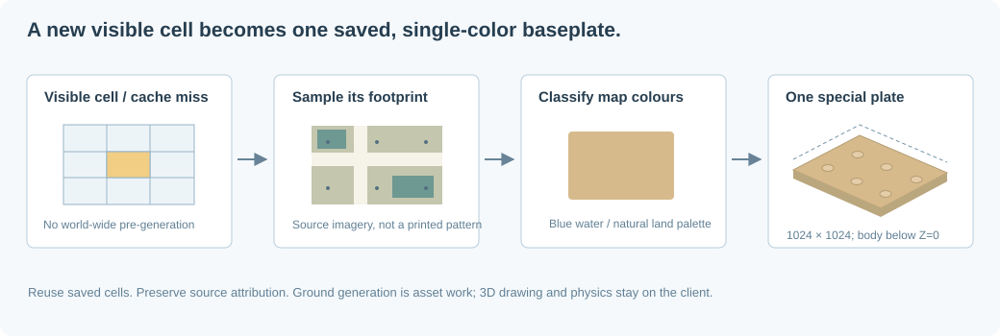

# Z-up coordinates and lazy single-color baseplates

## Public world and internal kernel

Schema 2 files and REST/MCP interfaces use **X east, Y north, Z height**.
The renderer/physics kernel uses X east, Y up, Z south. The conversion is the
proper rotation:

$$
Q=\begin{pmatrix}1&0&0\\0&0&-1\\0&1&0\end{pmatrix},\qquad
\mathbf{p}_{public}=Q\mathbf{p}_{kernel},\qquad
A_{public}=Q A_{kernel}Q^T.
$$

The determinant is +1, so winding, normals, chiral geometry, and positive rotation
angles are preserved. Bounds transform their minimum/maximum correctly rather
than independently treating them as arbitrary direction vectors.
`crates/world/src/coordinates.rs` is the interchange boundary; Rust kernel types
retain the internal convention. Schema-1 Y-up objects are preserved but rejected
or excluded from current listings rather than silently reinterpreted.

## Cells and geographic location

With $B=1024$, public cell indices are:

$$
(i,j,k)=\left(\lfloor x/B\rfloor,\lfloor y/B\rfloor,\lfloor z/B\rfloor\right).
$$

For angular resolution $a$ arc-seconds/cell:

$$
\phi=\phi_0+\frac{ay}{3600B},\qquad
\lambda=\operatorname{wrap}\left(\lambda_0+\frac{ax}{3600B}\right).
$$

Paris defaults to $(\phi_0,\lambda_0)=(48.8566^\circ,2.3522^\circ)$.
Height is independent of latitude/longitude. The inverse uses the shortest wrapped
longitude difference. Physical dimensions remain separate: X/Y units are 8 mm,
Z units are 9.6 mm. See [persistence indexing](persistence-indexing.md).

## The special baseplate

Each horizontal cell has a **1024×1024 virtual baseplate with one standard
material color**. It is not a regular imported catalog piece and is not counted
as a movable brick. Its visible top is at Z=$-0.01$ brick-height units
(-0.096 mm), and its thickness is one plate (3.2 mm). The physics support plane
is Z=0, so placed piece bases have height zero without z-fighting the display.

A part's LDraw reference origin can be above its base. For example, a brick placed
with minimum-corner Z=0 can have reference-origin Z=1. `bounds.min.z` is its base
height; the inspector displays both concepts.

Vertical storage cells do not create additional floors. Ground is a horizontal
Z=0 layer, even for constructions crossing vertical indexing boundaries.

## Lazy generation

The browser requests ground cells only as they enter the current frustum and
finite fog range. The server:

1. Checks the generated-cell cache in local storage or S3.
2. On a miss/needed refresh, samples imagery covering that geographic footprint.
3. Averages the samples, selects one enabled palette color, and stores the result.
4. Returns an empty construction cell (`bricks: []`) plus its single-color
   baseplate, source, timestamp, and attribution metadata.

There is no world-wide pre-generation or offline-region download job. Revisited
cells reuse saved results. A snapshot can retain the viewed baseplate metadata,
allowing MCP image tools to use it without requesting new map tiles in headless
automation.

## Average first, then project to the palette

The server samples a 32×32 grid across the footprint, not a multicolor print.
Convert source sRGB channels to linear light, compute their mean, and encode that
mean back to sRGB:

$$
\bar{\mathbf c}_{lin}=\frac1N\sum_{n=1}^N
\operatorname{linear}(\mathbf c_n).
$$

The single material code minimizes Euclidean CIELAB difference over the enabled
palette $P$:

$$
c^*=\arg\min_{c\in P}
\|\operatorname{Lab}(\bar{\mathbf c})-\operatorname{Lab}(c)\|_2.
$$

The record stores `color` (one LDraw code) and `sample_rgb` (the average), not a
per-stud texture. Lighting, fog, and the optional debug grid can vary rendered
pixels; they do not add material colors to the baseplate. The display palette is
defined in `catalog.rs` / `color_rgb`; RGB swatches are not spectral measurements.

## Map sources and projection

The default source is OpenStreetMap Carto raster imagery. **OSM is cartography,
not satellite photography.** Its average therefore reflects map styling.
`ERGO_MAP_TILE_URL` supports a configured, licensed XYZ PNG provider; Google
satellite is not automatically scraped or enabled without its proper service
configuration. Provider attribution must be set appropriately when changing source.

Web Mercator addresses source pixels with:

$$
u=2^\ell\frac{\lambda+180}{360},\qquad
v=\frac{2^\ell}{2}
\left(1-\frac{\operatorname{asinh}(\tan\phi)}\pi\right).
$$

Here $\ell$ is chosen from cell angular span/latitude, capped at zoom 18.
This avoids requesting hundreds of high-zoom tiles for an unusually large
configured geographic cell. A generation is limited to 16 source tiles and
Web Mercator's latitude coverage.

## Caching, failure, and attribution

Raw PNG tiles and derived ground cells are persisted separately. Source tiles
are cached for at least seven days; expired requests use ETag/Last-Modified
conditions where available. Requests use a stable application User-Agent and
configured public Referer. Only active viewing triggers generation. Follow the
[OSM tile policy](https://operations.osmfoundation.org/policies/tiles/).

The viewport shows visible source attribution. Configured provider URLs/keys are
kept server-side; exported provenance uses provider/tile identifiers rather than
credential-bearing URLs. Map failures produce an explicitly labeled one-color
fallback (light bluish gray), cached briefly and retried on demand.

Configuration is in [`.env.example`](../.env.example): `ERGO_GROUND_SOURCE`,
`ERGO_MAP_TILE_URL`, `ERGO_MAP_PROVIDER`, `ERGO_MAP_USER_AGENT`,
`ERGO_MAP_ATTRIBUTION`, and `ERGO_MAP_ATTRIBUTION_URL`.
