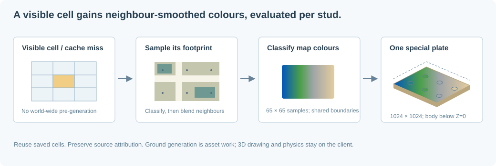

# Z-up coordinates and lazy per-stud baseplate colours



## Public world and internal kernel

Schema 2 files and REST/MCP interfaces use **X east, Y north, Z height**.
The `model` field in [Ergo construction files](construction-format.md) uses the
same public axes and brick units in its row-major homogeneous transforms.
The renderer/physics kernel uses X east, Y up, Z south. The conversion is the
proper rotation:

$$
Q=\begin{pmatrix}1&0&0\\0&0&-1\\0&1&0\end{pmatrix},\qquad
\mathbf{p}_{public}=Q\mathbf{p}_{kernel},\qquad
A_{public}=Q A_{kernel}Q^T.
$$

The determinant is +1, so winding, normals, chiral geometry, and positive rotation
angles are preserved. Bounds transform their minimum/maximum correctly rather
than independently treating them as arbitrary direction vectors.
`crates/world/src/coordinates.rs` is the interchange boundary; Rust kernel types
retain the internal convention. Unsupported coordinate schemas are rejected.

## Cells and geographic location

With $B=128$, public cell indices are:

$$
(i,j,k)=\left(\lfloor x/B\rfloor,\lfloor y/B\rfloor,\lfloor z/B\rfloor\right).
$$

For angular resolution $a$ arc-seconds/cell:

$$
\phi=\phi_0+\frac{ay}{3600B},\qquad
\lambda=\operatorname{wrap}\left(\lambda_0+\frac{ax}{3600B}\right).
$$

Paris defaults to $(\phi_0,\lambda_0)=(48.8566^\circ,2.3522^\circ)$.
Height is independent of latitude/longitude. The inverse uses the shortest wrapped
longitude difference. Physical dimensions remain separate: X/Y units are 8 mm,
Z units are 9.6 mm. See [persistence indexing](persistence-indexing.md).

## The special baseplate

Each horizontal cell has a **128×128 virtual baseplate with map-derived colours
evaluated per stud**. It is not a regular imported catalog piece and is not counted
as a movable brick. Its plate-body top is at Z=$-0.01$ brick-height units
(-0.096 mm), and its thickness is one plate (3.2 mm). The physics support plane
is Z=0, so placed piece bases have height zero without z-fighting the display.

The surface has one stud per horizontal construction unit, so a full plate has
128×128 stud positions. Cell height is 128 bricks, equivalently 384 plates.
Nearby visible studs use instanced cylinders
(4.8 mm diameter, 1.6 mm high). The renderer considers at most a 193×193 local
grid, then frustum/distance culls it. Near cylinders use 16 sides and distant
cylinders use 8. Geometric height blends over a wide band into derivative-filtered
relief; the 94-unit radius stays inside the grid. See [stud LOD](stud-lod.md).
Farther studs use derivative-filtered shader
relief that fades when subpixel; a million separate meshes are never allocated.
Studs do not change the flat navigation/dynamic-physics support plane. The static
commit gate independently checks grounded receiving interfaces against the
baseplate grid. Reviewed tyres instead bear on the flat ground below their axle
line, without engaging studs or requiring a road/display plate. Visual studs are
not the acceptance test.

A part's reference origin can be above its base. For example, a brick placed
with minimum-corner Z=0 can have reference-origin Z=1. `bounds.min.z` is its base
height; the inspector displays both concepts.

Vertical storage cells do not create additional floors. Ground is a horizontal
Z=0 layer, even for constructions crossing vertical indexing boundaries.

## Placement grid and proper transforms

Ground stud centres are at half-integer X/Y coordinates. Standard upright nominal
part footprint edges therefore register on integer coordinates. CAD placements
snap horizontally to one stud and vertically to one plate (1/3 native height),
using nearest rounding with half ties away from zero. Whole-model snapping uses
the lowest upright receiving stud grid when available, with nominal union bounds
as fallback. This preserves the registration of moulded figure feet even when
held equipment or rounded foot envelopes extend outside that grid.

`place_brick` snaps the requested minimum corner. Submodels, import previews,
connected moves and authoring-group transforms receive one coherent translation
of their receiving-grid datum or nominal union corner; constituent poses and joint frames retain their
relative layout. Snapping does not repair an internally misregistered model.
The independent commit check rejects grounded pieces whose footprint is still
off grid. Odd-sized part centres need not be integers, and this is not a blanket
integer-coordinate requirement for every elevated detail.

Camera motion and saved private camera/target remain continuous. Only the
suggested standing-model origin returned by `get_user_position` is rounded.
Accepted history is not automatically rewritten by the new placement rules.
See [validation gates](validation-gates.md) for authoritative checks and
[construction format](construction-format.md) for proper metric isometries.

## Lazy generation

The browser requests ground cells only as they enter the current frustum and
finite fog range. The server:

1. Checks the generated-cell cache in local storage or S3.
2. On a miss/needed refresh, styles the relevant OSM vector tile or samples an
   explicitly configured raster source covering that geographic footprint.
3. Classifies the nearest source pixel into the standard terrain palette and
   stores a boundary-inclusive colour field without colour interpolation.
4. Returns an empty construction cell (`bricks: []`) plus the baseplate field,
   representative colour, source, timestamp, and attribution metadata.

There is no world-wide pre-generation or offline-region download job. Revisited
cells reuse saved results. A snapshot can retain the viewed baseplate metadata,
allowing MCP image tools to use it without requesting new map tiles in headless
automation.

The browser only preloads retained colour fields matching the current
`ground_provider` advertised by `/api/config`; changing from OSM to satellite
imagery therefore refreshes the live view instead of reusing an old cartographic
snapshot colour. Retained old uniform records are refreshed on demand in the live
viewer; they remain readable offline, including in MCP captures. No model cache
is erased to upgrade the derived ground display.

The current browser also persists successful public colour fields in its
checksum-verified IndexedDB. Keys include coordinates, geographic reference and
the `ground_revision` advertised by `/api/config`, derived from the server's
source/provider/attribution, palette, sampling version and cell-format signature.
Fresh fields are reusable locally for seven days, including after reload. Expired
fields use conditional HTTP revalidation; palette fallback/error responses are
`no-store` and retain their ordinary short retry policy. A provider/settings
revision change cannot reuse the previous field. This public floor cache does
not authorize offline access to constructions.

## Natural map palette

The default basic OSM style draws available forest/woodland, grass/parks, water,
snow/glacier and rock polygons in discrete natural LEGO colours. Roads and streets
have simple white surfaces and grey borders. Place names, road names, water/park
names, summits and selected main cultural/historic landmarks are labelled. It is
not a complete scientific land-cover or elevation dataset: mountains have map
features/names, not physical height changes to the flat support plane.

Commercial POIs are excluded from vector feature classes before label placement.
Shops, offices, banks, hotels, cafes, bars, pubs and restaurants do not acquire
labels/icons. Landmark POIs use a small allowlist (such as museums, monuments,
castles, archaeological sites and places of worship) and source rank filtering;
unknown POI classes fail closed. A business's landmark-like name cannot bypass its
class. Crowded labels are collision-filtered, so not every landmark is named at
every zoom. This is filtering OSM classifications, not a guarantee that upstream
OSM tagging is complete or correct.

The small bitmap label font supports Latin/Latin-1 and Greek, prefers available
Latin names and falls back to English names; unsupported scripts are omitted.
The map is styled server-side without browser map SDKs, cookies, registration or
API keys. Explicit external raster sources retain baked-in details: their labels
cannot be selectively filtered. Source resolution does not acquire stud-scale
geographic detail merely because the renderer evaluates each stud separately.

For optional satellite/custom imagery, each source pixel selects the nearest
CIELAB swatch from the same restricted natural palette. Both paths choose the
nearest source pixel, including neighbours across tile edges; they never blend
material swatches into an intermediate colour.
Longitude wraps at the dateline; pole-edge neighbour rows clamp to coverage.

The persisted `surface` is `ergo-ground-surface-1`: **65×65 row-major 24-bit sRGB
samples**, columns east and rows north, including both cell boundaries. Samples
are spaced two studs apart, occupying 16,900 uncompressed RGB32 bytes per cell.
Every stud chooses an exact standard swatch at its half-integer centre. The four
field corners contribute bilinear weights to colour classes; repeated colours
combine their weights. For class $c$ and local field coordinates $(u,v)$:

$$
w_c=\sum_{i\in\{00,10,01,11\}}w_i[c_i=c],\qquad c^*=\arg\max_c w_c,
\quad(w_{00},w_{10},w_{01},w_{11})=((1-u)(1-v),u(1-v),(1-u)v,uv).
$$

Each displayed material is one exact standard palette RGB swatch, with lower RGB
code breaking ties. Categorical voting rounds region corners instead of making
hard rectangular sample patches or RGB gradients. The GPU fetches four swatches
from a 65×65 RGBA8 texture (16,900 bytes). Identical fields share one GPU texture
across plates. A 256-pattern LRU retains reusable textures across camera-cell
eviction and construction replacements within the same renderer, plus textures
still referenced by visible plates; active references prevent premature GPU
deletion. Nearby stud cylinders use
the same vote at their centres; the base evaluates it continuously to round
borders between studs.
Ordinary lighting, shadows and distance fog still shade those materials.

Current fields require `cell_size:128`. Incompatible cached fields are deleted,
not read in an old-grid mode. Source samples are projected into the standard
palette before voting. The derived signature includes
`ground-standard-categorical-v3` and the cell span. See [migration/cache
invalidation](cells-and-migration.md); raw source-raster cache policy is unchanged.

Adjacent cells sample identical geographic boundary positions at the same source
zoom. With the same cached source pixels their boundary values therefore agree,
including source-tile boundaries.
The field is a discardable display derivative; it does not add parts, change
physical geometry, consume edit allowance, or recolour authored constructions.

`color` remains a representative palette code (dominant OSM class, or nearest
swatch to average imagery). `sample_rgb` remains the linear-light average of
sampled source colours, re-encoded to sRGB. Those fields support provenance and
legacy/fallback display; they no longer flatten a successful field to one colour.
The palette is defined in `catalog.rs` / `color_rgb`; RGB swatches are not spectral
measurements. Implementation: `world/src/terrain.rs`, `assets/src/ground.rs`,
`client/src/scene/ground.rs` and `client/src/renderer/{batches,shaders}.rs` under
`crates/`.

## Map sources and projection

The default `ERGO_GROUND_SOURCE=osm` uses the **Ergo basic OSM** style over
[OpenFreeMap](https://openfreemap.org/quick_start/) / OpenMapTiles vector data,
with visible OpenStreetMap, OpenMapTiles and OpenFreeMap attribution. Source tiles
come from `https://tiles.openfreemap.org/planet/latest/{z}/{x}/{y}.pbf`; source zoom
is capped at 14 and geometry is overzoomed for display/sampling up to 18.
`ERGO_MAP_VECTOR_TILE_URL` can select another compatible OpenMapTiles source.
The style identifier `ergo-basic-osm-v1` participates in both derived-cache keys
and the provider identity used to screen retained snapshot fields. Thus old
business-labelled ground fields are not reused as this style, even if an operator
retains a custom provider name.

`satellite` optionally selects Esri World Imagery.
The sampled footprint determines the baseplate's spatial colour field.
`ERGO_MAP_TILE_URL` supports alternative XYZ **PNG or JPEG**
imagery with `{z}`, `{x}`, and `{y}` placeholders and 256×256 tiles. Set matching
provider attribution when changing the source. Raster and vector URL overrides are
mutually exclusive. `disabled` uses the labeled palette fallback.

For an explicit one-tile local preview, with the default clean source:

```sh
cargo run --release -p ergo-assets --example preview_map -- \
  48.85822222 2.2945 18 target/map-preview.png
```

Web Mercator addresses source pixels with:

$$
u=2^\ell\frac{\lambda+180}{360},\qquad
v=\frac{2^\ell}{2}
\left(1-\frac{\operatorname{asinh}(\tan\phi)}\pi\right).
$$

Here $\ell$ is chosen from cell angular span and the geographic reference latitude,
capped at zoom 18 and shared by neighbouring cells.
This avoids requesting hundreds of high-zoom tiles for an unusually large
configured geographic cell. A generation is limited to 16 source tiles and
Web Mercator's latitude coverage.

## Caching, failure, and attribution

Raw MVT or PNG/JPEG tiles and derived ground cells are persisted separately. Source tiles
are cached for at least seven days; expired requests use ETag/Last-Modified
conditions where available. Requests use a stable application User-Agent and
configured public Referer. Only active viewing triggers generation. Use the
configured provider's service terms and attribution. The default uses the
[OpenFreeMap public service](https://openfreemap.org/); an explicitly configured
OSM raster endpoint follows its [tile policy](https://operations.osmfoundation.org/policies/tiles/).
Vector downloads are limited to 4 MiB, decoded tiles to 8 MiB, selected geometry to
300,000 points and input tiles to 50,000 features. A malformed vector tile is
rejected before source persistence. A sixteen-entry, sixty-second rendered-tile
cache avoids repainting the same tile for adjacent ground cells. Neither source
cache contains world geometry or changes permissions, physical models or bricks.

The viewport shows visible source attribution. Configured provider URLs/keys are
kept server-side; exported provenance uses provider/tile identifiers rather than
credential-bearing URLs. Map failures produce an explicitly labeled one-color
fallback (light bluish gray), cached briefly and retried on demand.

Configuration is in [`.env.example`](../.env.example): `ERGO_GROUND_SOURCE`,
`ERGO_MAP_VECTOR_TILE_URL`, `ERGO_MAP_TILE_URL`, `ERGO_MAP_PROVIDER`, `ERGO_MAP_USER_AGENT`,
`ERGO_MAP_ATTRIBUTION`, and `ERGO_MAP_ATTRIBUTION_URL`.
