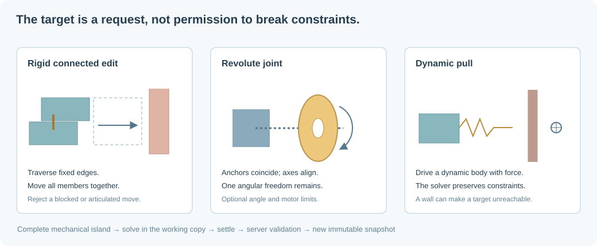

# Constraint solving for interactive positioning

## Two interaction modes, two guarantees

Moving a selected part can mean either a rigid edit or dragging a mechanism.
Treating both as setting the selected part's transform would break connections
and allow motion through other bricks.

**Rigid edit:** find the selected brick's fixed-connected component, propose a
common displacement, and accept it only if the move is collision-free and does
not violate anchored or articulated constraints.

**Dynamic pull:** apply a bounded drive force to a dynamic selected body. The
physics solver moves connected bodies, enforces hinge freedoms, and resolves
contacts. The target is an intention, not a guaranteed reachable position.

Both modes operate on a complete loaded working set. A body hidden by camera
culling is still an obstacle or support. Saving validates the resulting static
configuration separately.

## Representing a constraint graph

Let $G=(V,E)$ where each vertex is a brick or rigid aggregate and each edge is a
mechanical constraint. A stored constraint contains endpoint IDs, an anchor, a
type, optional revolute limits, and an optional break-force threshold.

Spatial relationships and mechanical relationships differ. The octree finds
nearby parts; the graph says which parts must move together or share a degree
of freedom. Rebuildable spatial indexes should not be the only place a
mechanical connection exists.

### Fixed connections

A fixed joint removes all six relative degrees of freedom. For poses
$T_i,T_j\in SE(3)$ and rest relative pose $T_{ij}^{0}$:

$$
T_i^{-1}T_j=T_{ij}^{0}.
$$

Traverse only fixed edges to compute the rigid movement group. Union-find is
efficient for one-time grouping; a graph traversal is simpler when connections
are edited or broken. The implementation traverses fixed edges and checks that
none of the selected group's IDs are anchored.

### Revolute joints: a wheel around an axle

A revolute joint removes five relative degrees of freedom and leaves one angular
coordinate $\theta$. With local anchors $\mathbf{a}_i,\mathbf{a}_j$ and local
unit axes $\mathbf{u}_i,\mathbf{u}_j$:

$$
\mathbf{x}_i+R_i\mathbf{a}_i
=\mathbf{x}_j+R_j\mathbf{a}_j,
$$

$$
(R_i\mathbf{u}_i)\times(R_j\mathbf{u}_j)=\mathbf{0}.
$$

Anchor coincidence supplies three independent conditions; aligned axes supply
two. Optional limits impose $\theta_{min}\le\theta\le\theta_{max}$. A motor
can request angular velocity or position, subject to torque limits.

The initial catalog contains basic bricks, plates, and tiles, not wheel or axle
meshes. Revolute constraints are supported and tested now; adding real wheel
parts later does not require changing the joint model. Their collision boxes may
be a poor approximation to the wheel bore or tire, so explicitly connected pairs
can disable mutual collision while still colliding with other objects.

## Reference coordinates and transformed anchors

Studio/LDraw uses 20 LDraw units per stud and 24 per brick height, with a different
axis convention. The geometry conversion is:

$$
C_{public}=\begin{pmatrix}1/20&0&0\\0&0&1/20\\0&-1/24&0\end{pmatrix}.
$$

For an LDraw rotation/transform $R$ and translation $\mathbf{t}$:

$$
A_{world}=C_{public}RC_{public}^{-1},\qquad \mathbf{p}_{world}=C_{public}\mathbf{t}.
$$

Because construction axes have different scales, $A_{world}$ need not be a
pure orthogonal rotation even when $R$ is. Do not discard the full affine
transform by blindly converting it to a unit quaternion. Visual geometry and
physics body bounds must agree about this conversion.
Public axes are X east, Y north, Z up. The kernel uses an explicit proper-rotation
adapter. Joint axes are directions in orthonormal metric ENU axes, while position
and pivot values use construction units.

A stored anchor is expressed in the snapshot's world/reference frame. At
simulation creation it is converted into local body frames. After simulation,
export the updated world anchor and axis from the solved poses. Reusing the old
world anchor would snap the assembly back when reopening it.

## Collision-aware rigid translation

For a group $S$ and desired translation $\Delta\mathbf{x}$:

$$
\mathbf{x}'_i=\mathbf{x}_i+\Delta\mathbf{x}\quad(i\in S).
$$

Internal fixed relationships remain unchanged. Test the moved boxes against
bricks outside $S$ and the baseplate. Checking only the final pose permits
tunneling through an obstacle in the middle of the path.

The current preflight samples the path in steps no larger than 0.05 units,
rejects moves above 32 units, and uses conservative world AABBs. This is useful
for unit nudges, but **finite sampling is not a general continuous-collision
guarantee**. An arbitrarily thin obstacle can lie between samples.

The next improvement is a swept shape cast. Find the earliest normalized time of
impact $t^*\in[0,1]$ along the proposed displacement and clamp to:

$$
\Delta\mathbf{x}_{accepted}
=\max(0,t^*-\epsilon_t)\Delta\mathbf{x}.
$$

The broad-phase query should cover the union of start and end bounds. For
rotations, use a conservative swept volume and convex motion casting; a
translation-only sweep does not bound rotating corners.

An explicit revolute edge crossing the rigid group is not ignored: the editor
rejects the simple rigid edit and directs the interaction to the simulation
solver instead.

## Dynamic, force-limited dragging

The selected body remains dynamic. A critically damped drive in SI units requests
acceleration (with gravity compensation for the selected body):

$$
\mathbf{a}_{drive}=k_p(\mathbf{x}_{target}-\mathbf{x})-k_d\mathbf{v}-\mathbf{g},
$$

$$
\|\mathbf{a}_{drive}\|\le a_{max},\qquad
\Delta\mathbf{p}=m\mathbf{a}_{drive}\Delta t.
$$

The implementation uses $k_p=2500\ \mathrm{s^{-2}}$, $k_d=100\ \mathrm{s^{-1}}$,
$a_{max}=50\ \mathrm{m\,s^{-2}}$, and a fixed step of $1/120$ second. These are
interaction settings, not material properties. Compensation applies to the
selected body's weight, not an unlimited force capable of lifting any assembly.

The body can stop at a wall while the cursor/target continues moving. A fixed
neighbor follows the driven body; a hinged neighbor rotates within its allowed
degrees of freedom. Release the drive when the user finishes the action.

Do not make the selected body an infinitely powerful teleporting kinematic body:
it can push through contacts and inject unreasonable energy. A bounded motor or
compliant temporary drag joint gives a more controllable interaction. Large
mass ratios, long chains, closed loops, or highly overconstrained mechanisms may
need additional solver iterations and compliance.

## Position-based optimization: a future editor solver

For precise CAD-like positioning, a quasi-static constrained optimization may be
more intuitive than running gravity during every drag. For pose vector
$\mathbf{q}$, target $\mathbf{t}$, and previous pose $\mathbf{q}_0$:

$$
\min_{\mathbf{q}}\quad
\tfrac12\|h(\mathbf{q})-\mathbf{t}\|_W^2+
\tfrac\alpha2\|\mathbf{q}-\mathbf{q}_0\|^2
$$

subject to:

$$
C_{joint}(\mathbf{q})=0,\qquad
g_{contact}(\mathbf{q})\ge0,\qquad
\theta_{min}\le\theta\le\theta_{max}.
$$

The regularizer chooses a nearby solution when the mechanism has multiple valid
poses. Linearize locally, solve sparse increments with an active set or a
compliant position-based method, and limit steps to preserve collision safety.
The objective is nonconvex: there may be multiple solutions or none. Report an
unreachable target rather than silently breaking a joint.

This optimization is a proposed precision-editing layer. The implemented initial
interaction uses fixed-group nudges and Rapier's dynamic constraint solve.

## Undo, isolation, and publication

The loaded immutable snapshot and working copy are conceptually distinct. The
current UI remembers the original complete working scene for a reset; it is not
yet a multi-step command-history undo stack. A simulation freezes streaming so
eviction cannot remove a live support or joint endpoint.

After manipulation:

1. Pause and release the drive.
2. Capture solved poses and current unbroken constraints.
3. Export or keep the working copy, including an unstable experimental state.
4. On save, let the server recompute bounds and run the overlap/stability gate.
5. Publish a new immutable snapshot only if validation passes.

Future collaborative editing should record commands against a base revision,
detect conflicting changes to the same connected island, and revalidate on the
server. Shared editing cannot rely on one browser's transient solver state.

## Nested authoring groups

Persistent [authoring groups](groups.md) can contain pieces and other groups.
Their transforms update flat world-space piece poses and descendant pivots once.
They are independent of fixed/revolute physical bonds. Group rotations validate
destination boxes rather than claiming a continuous rotational sweep, and
constraints to outside pieces block a direct CAD transform.
