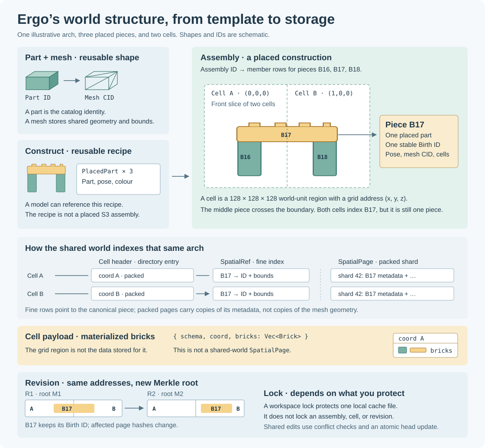
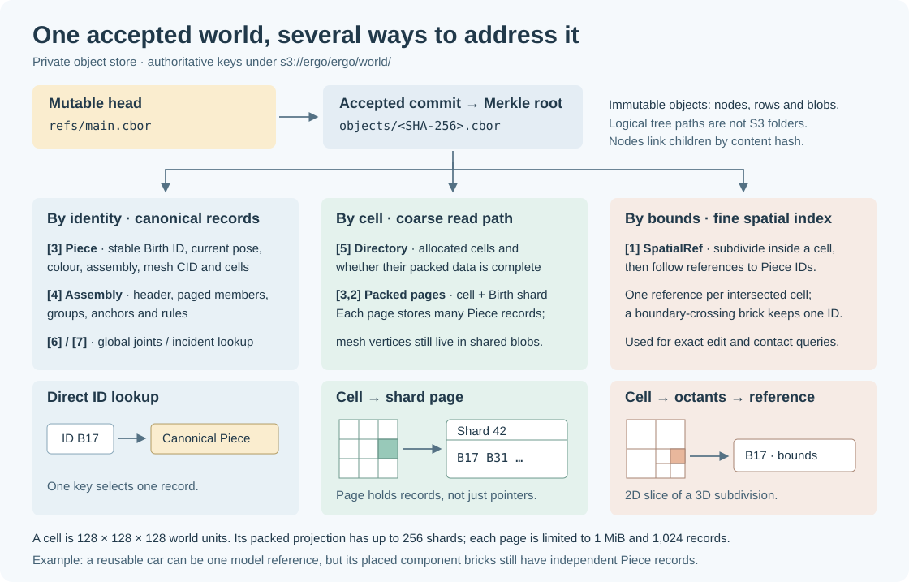
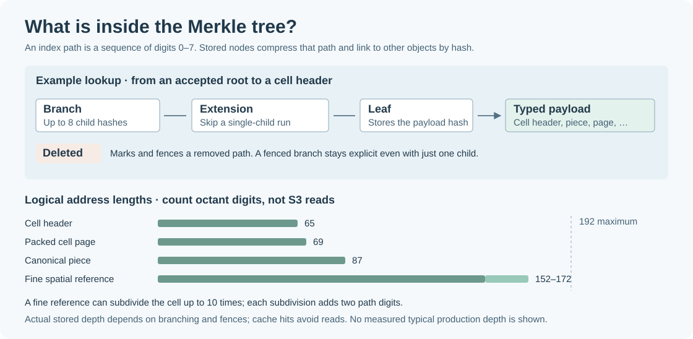
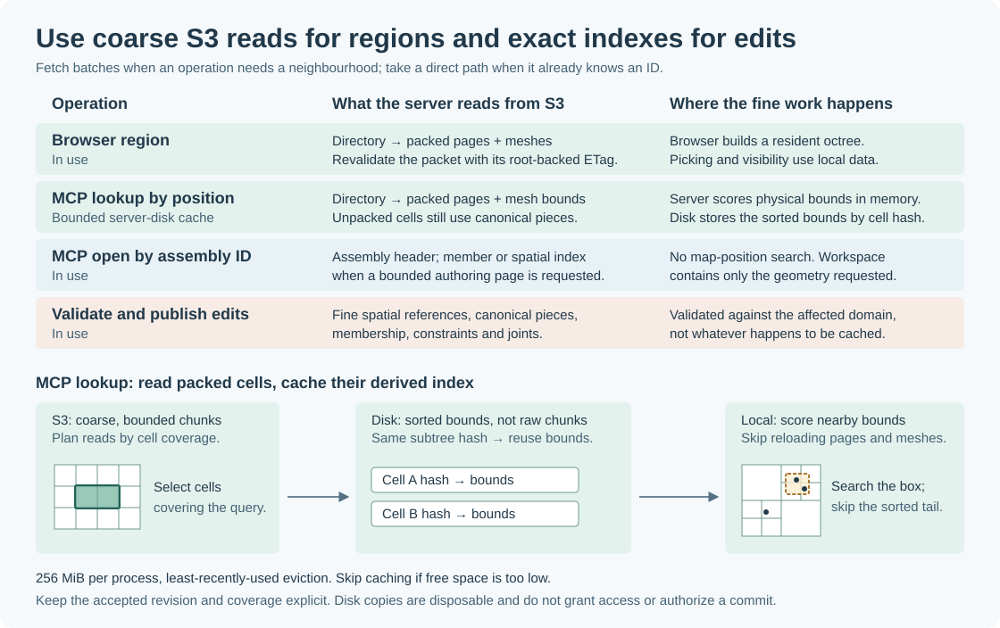
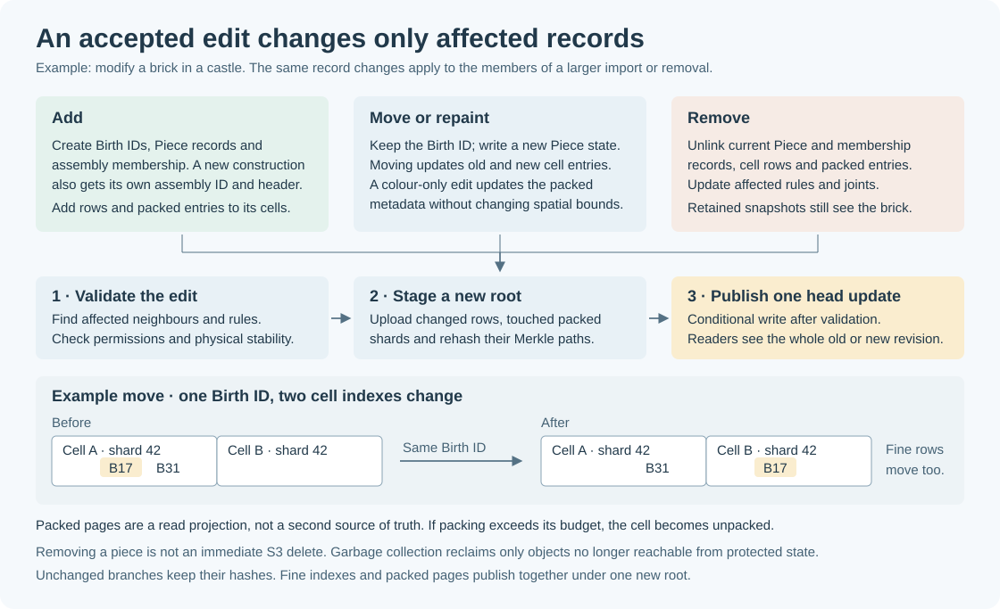

# Spatial persistence indexing

The authoritative world is an immutable, content-addressed, packed octree selected
by one conditional head. Its address space and derived rendering index serve
different purposes; neither is a mechanical attachment graph.

## Coordinates and cells

The **cell** is the region; its **cell coordinate** is the grid address. A
**cell header** marks an allocated cell, and a **packed cell page** stores
shared-world piece metadata. A **materialized cell payload** instead contains
the coordinate and decoded bricks. A reusable **construct** is a recipe;
an **assembly** is a placed construction with its own ID and member **pieces**.
The **revision** selects the state of those pieces and cells. It does not change
their addresses or reserve them for one editor.

Public axes are X east, Y north, Z up. A storage cell has side B=128 construction
units. For a position p, each cell index is `floor(p/B)`, including negative values.
One default horizontal cell maps to one arc-second; geographic origin/resolution
are stored in Metadata. This address mapping does not determine physical length.

Nominal physics uses 8 mm horizontal pitch and 9.6 mm vertical brick height.
The global floor is Z=0 independently of vertical cell boundaries. See
[ground and coordinates](ground-and-coordinates.md).

## Merkle nodes and index depth

Signed i64 cell coordinates are sign-biased and interleaved into 64 octants, with
`q=x_bit+2*y_bit+4*z_bit`. The application adds typed leading octants for policy,
spatial rows, metadata, pieces, assembly rules, allocated-cell directory and joints.
Full hash identities are padded/interleaved into 86 octants.

The root and its descendants are immutable, hash-addressed tree nodes. A
**Branch** holds up to eight child hashes. An **Extension** stores a run of
consecutive single-child, unfenced steps and the next node's hash. A **Leaf**
holds the hash of a typed payload, such as a piece or packed cell page. A
**Deleted** node is a tombstone. Branches, leaves, and tombstones can carry
replacement fences so transactions can detect that a path was replaced.

**Common logical depths**, counted in octant digits from the root:

- **Cell header: 65** = 1 record-family digit + 64 coordinate digits.
- **Packed cell page: 69** = 2 record-family digits + 64 coordinate digits + 3 shard digits.
- **Canonical piece: 87** = 1 record-family digit + 86 Birth ID digits.
- **Fine spatial reference: 152–172** = 65 cell-path digits + 0–20 local
  subdivision digits + 1 reference marker + 86 Birth ID digits.

The path limit is **192 digits**, not 192 stored nodes or S3 reads. For example,
three neighbouring cell addresses `(0,0,0)`, `(1,0,0)` and `(0,1,0)` share their
first 63 coordinate digits. One extension can encode that shared run, followed
by a branch on the last digit. Actual traversal depth depends on the populated
keys and fences; remote reads also depend on cache warmth and prefetch. These
are format-derived depths, not a measured production average. See
[wire formats](object-store-formats.md) for the encoded records.

Decoded immutable read nodes are discardable: each tree keeps an accounted 8 MiB
FIFO cache instead of retaining every node visited across all pages. Staged nodes
remain distinct and are never evicted by that cache, and read predicates are still
retained for serializable publication. Canonical encoding streams arrays and
buffers only encoded map entries for key sorting; it preserves existing bytes
and hashes, not a new storage format. See [memory limits](loading-and-cache.md).

## Boundary-crossing objects

Render bounds, including details, determine intersected storage cells. A piece
keeps one stable Birth identity and separately versioned pose/mesh state. The
fine index contains reference-only SpatialRef rows; packed pages separately copy
Piece metadata, not the mesh vertices. Replicas are deduplicated before rendering;
the entire part remains available across a boundary. Replication is bounded to
64 cells per piece.

Within a cell, adaptive reference nodes retain large split-crossing extents near
their parent. Child `0` holds own references; `1/q` descends by octant, up to ten
local levels. An allocated-cell directory supports sparse bounded enumeration.

## Bulk spatial reads and local traversal

Spatial layout 4 maintains a complete read projection per packed cell, alongside the
unchanged edit/contact index. Up to 256 bounded pages hold full brick metadata
and shared-mesh references. A region reader bulk-downloads pages, deduplicates
boundary replicas, then builds/traverses the resident octree locally. It avoids
one path lookup and payload GET for every brick. Page bytes and index nodes reuse
the server's verified 256 MiB object LRU by immutable CID.

Only touched hash shards are read/updated during an edit. The projection and
canonical records publish in the same head CAS; colour/mesh changes, moves and
deletions cannot leave a separately published stale page. Mechanical discovery
and validation still use canonical pieces and their original spatial predicates.
Projection updates have a separate bounded 64 MiB allowance for loaded pages and
added record bytes; overflow
falls back to the reference index rather than rejecting otherwise valid geometry.

Only layout 4 and `cell_size:128` run. Cells in older layouts require the
[atomic cell migration](cells-and-migration.md); no legacy grid mode remains.
The term **cell** in these docs does not rename persisted keys or public API
routes. See the [packed-cell release gate](storage-operations.md#release-gate-for-the-packed-cell-lookup)
for the production inventory and eager backfill procedure.
`shared-pack-block WORLD_ID X Y Z` backfills a current unpacked cell under a
whole-root optimistic watch, without changing piece payloads, births, poses or
physics. `shared-pack-region WORLD_ID X Y Z [RADIUS]` enumerates the allocated
cells of the bounded cube with the region reader's sparse directory scan and
packs each unpacked one. Current unpacked cells retain the normal reference
reader until packed.
`shared-pack-world WORLD_ID [--check]` covers all allocated cells in bounded pages
and verifies unchanged canonical Merkle subtrees; see the
[whole-world migration runbook](storage-operations.md#whole-world-packing).

The historical 4,096-brick cold-store fixture observed 574 GETs for packed reads versus 25,263
for the reference/per-piece path, with identical scene geometry. This measures
request-count reduction in an isolated store, not a production latency guarantee.

Packing trades storage and some overfetch for fewer remote requests. That matters
for a region read: walking a fine remote index can require many dependent GETs
before the reader has enough data to answer, even when each response is small.
When only an assembly or piece ID is needed, follow its identity index rather
than downloading a region. The fine index also remains authoritative for edit
dependencies, where permissions, staged edits and concurrent changes matter.

The browser caches completed region packets locally and builds a resident octree.
For MCP position lookup, the server builds a per-cell index of physical bounds
sorted by their lower X edge. Queries skip the tail outside the search extent,
then score the remaining candidates in three dimensions. On repeat requests, the
server reuses these bounds from disk without rereading packed pages or meshes.
See the [MCP lookup figure](figures/mcp-position-lookup.svg).

The cache stores the derived bounds, not whole chunks or mesh bytes. It is keyed
by the packed cell's subtree hash in the accepted snapshot, so unchanged cells
can be reused after unrelated edits. Per process, the cache charges at most
**256 MiB**, admits at most **512** entries, and caps each encoded entry at **2 MiB**.
Writes check for **1 GiB** of free-space headroom after the new entry; this is an
admission check, not a reservation against concurrent scratch users. Eviction
closes the least recently used anonymous files. Process exit releases all files;
the cache does not survive restart. Contention, I/O errors, an oversized entry,
or unavailable space do not block lookup: it can still read from S3. No cached
bounds authorize edits or make an incomplete region authoritative.

## Revisions and locks

- **Lookup:** First select an accepted commit, by the current head or a retained
  revision CID. Its root selects the cell directory, packed pages, fine spatial
  rows and canonical records together. Then look up the cell, bounds or ID. A
  revision is not a fourth octree axis. The same cell address or piece Birth ID
  can resolve to different contents under different roots.
- **Reuse:** A moved piece keeps its Birth ID, but its state, affected cell
  references and packed shards can change. In the **Merkle tree**, each parent
  links to its children by content hash. Changing a leaf changes the hashes
  along its path to the root. Untouched branches keep their CIDs; cached
  immutable objects can still be reused by hash. A workspace page cursor still
  belongs to its original revision and query. Each request rechecks permission and retention;
  if that revision is no longer retained, reopen rather than mixing revisions.
- **Revalidation:** A complete browser view has a separate HTTP ETag that
  includes the accepted Merkle root and the requested view parameters. An
  authorized conditional `HEAD` returns `304` on a match, with no geometry
  transfer. On a mismatch, `HEAD` returns headers only; the client fetches the
  view if needed. An edit outside the view can therefore invalidate the
  complete packet even when its underlying cached objects still match by CID.
  The MCP per-cell disk index can reuse unchanged subtrees across revisions;
  the complete browser-view ETag does not do that. See
  [freshness checks](loading-and-cache.md#fast-merkle-backed-freshness-checks).
- **Local lock:** MCP locks one working copy against another local process
  opening the same path. It does not reserve a piece, assembly or cell in S3.
- **Shared publication:** Multiple editors can work concurrently. Publishing
  checks the transaction's observed dependencies and conditionally updates the
  head (compare-and-swap). If intervening edits leave the dependencies intact,
  the transaction can rebase. A dependency conflict requires recomputing from
  an accepted base, not blindly resending a stale edit.
- **Maintenance barrier:** Active storage readers and writers hold shared,
  durable pins. They do not exclude other ordinary readers or writers; they
  exclude an exclusive maintenance barrier. Once held, the barrier blocks new
  operations. Neither pins nor barriers expire on a timer. A revision CID or
  cursor is not a pin held between requests.

See [paged reads](paged-authoring.md#reading-bounded-views),
[concurrent editing](concurrent-global-editing.md), and
[storage operations](storage-operations.md) for the full contracts.

## Rules and dependencies

Assembly headers link native model descriptions and mesh blobs. Membership,
adjacency, endpoint joints, anchors and groups are paged; ordinary geometry edits
load the relevant rows instead of a world-sized graph. Explicit global joints
link assemblies. The server follows old/new contact/constraint/group closures and
swept spatial predicates; oversized domains are rejected, not truncated.

## Publication and residency

Immutable payloads/nodes and audit metadata stage before head CAS. Accepted
history is indexed by CID/sequence, and each Commit has a materialized root.
On add, a new assembly gets an ID and header; its individual bricks get Birth IDs
and membership rows. Adding a reusable construct can retain its compact model
reference, while its placed component bricks still get individual records.
Removing pieces unlinks their current state, relevant memberships and spatial
entries. Older retained roots still reference the old state; world garbage
collection traces schema links under a durable maintenance barrier before
reclaiming unreachable objects.

The browser separately selects bounded nearby cells, decodes/deduplicates records,
builds a resident octree and plans part/LOD batches. Camera eviction never defines
a complete physics domain. Native asset, terrain and account caches have separate
namespaces and retention rules.

Source: `crates/transactions/src/{path,tree,lib}.rs`,
`crates/server/src/shared/{address,spatial,bulk,world_pack,paged,working}.rs`.
