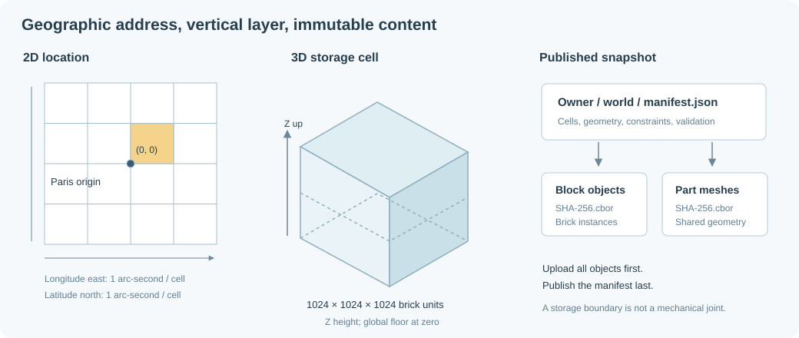

# Large-scale 2D/3D indexing for persistence

## Addressing a geographic brick world

Use public coordinates $(x,y,z)$ with X east, Y north, Z up. A storage cell contains
$B^3$ logical units with $B=1024$. The signed cell coordinate is:

$$
(i,j,k)=\left(\left\lfloor x/B\right\rfloor,
\left\lfloor y/B\right\rfloor,
\left\lfloor z/B\right\rfloor\right).
$$

Floor is essential: $x=-0.1$ belongs to cell $i=-1$, not $i=0$. A portable
integer implementation uses Euclidean division, not truncating division.

For origin latitude $\phi_0=48.8566^\circ$, longitude
$\lambda_0=2.3522^\circ$, and angular cell resolution $a$ arc-seconds:

$$
\phi=\phi_0+\frac{ay}{3600B},\qquad
\lambda=\operatorname{wrap}_{[-180,180)}
\left(\lambda_0+\frac{ax}{3600B}\right).
$$

The inverse uses the shortest wrapped longitude difference. Z is not encoded by
latitude/longitude; it remains a separate vertical layer. Latitude must remain
within $[-90,90]$. The mapping becomes unsuitable as a metric coordinate system
near the poles, even though it remains a useful addressing convention away from
them.



## Geographic addressing is not a physical scale

An arc-second is angular, not a fixed metric length. With Earth radius $R$:

$$
L_{north}\approx R\frac{\pi}{180\cdot3600},\qquad
L_{east}\approx R\cos\phi\frac{\pi}{180\cdot3600}.
$$

Near Paris these are approximately 30.9 m north–south and 20.3 m east–west.
Dividing by 1024 gives approximately 30 mm and 20 mm per logical horizontal unit,
respectively, not a physical brick's 8 mm stud pitch.

Consequently the geolocation mapping must not determine masses, inertia, gravity,
or real material stress. Current simulations convert construction coordinates to
SI with 8 mm per X/Y unit and 9.6 mm per Z unit, use sourced catalog masses, and
keep the GPS address mapping separate. See [physical calibration](physical-calibration.md).

## Cell ownership and replication

The private-snapshot block format contains whole brick records in every intersected cell.
Brick IDs remain unique within a construction. On load, all replicas with the
same ID represent one brick and must agree on its pose and part ID.

For a brick AABB $[\mathbf{b}_{min},\mathbf{b}_{max})$, its cell range is:

$$
\mathbf{k}_{min}=\left\lfloor\frac{\mathbf{b}_{min}}B\right\rfloor,
\qquad
\mathbf{k}_{max}=\left\lfloor\frac{\mathbf{b}_{max}-\boldsymbol\epsilon}B\right\rfloor.
$$

The upper bound is half-open so a face exactly on a boundary does not create a
zero-volume neighbor reference. Render bounds include studs; physics bounds do
not. Replication is bounded and malformed oversized objects are rejected.

**Implemented shared-world format:** spatial blocks contain global piece IDs;
an authoritative identity trie selects each piece's version in the same immutable
snapshot. Cross-page replicas do not contain separately editable geometry copies.
Stable IDs hash creation records including an instance nonce; pose edits change
versions while preserving identity. Metadata and reads are described in
[shared-world editing](concurrent-global-editing.md).

## Current object layout

All application state is stored as objects. There is no SQL database:

```text
<prefix>/
  users/<user-id>.json
  worlds/<owner-id>/<world-id>/manifest.json
  worlds/examples/<world-id>/manifest.json
  objects/<sha256>.cbor
  assets/v2/parts/<part>.json
  assets/ldraw/source/<dependency>.json
  ground/blocks/<configuration-hash>/<x>_<y>.cbor
  ground/source/<provider-hash>/<zoom>/<x>/<y>.cbor
```

A manifest contains schema version, bounds, geographic origin, block coordinates
and hashes, part-geometry hashes, nested authoring groups, cached one-color ground
records, explicit constraints, anchored brick IDs, and
the validation report. Shared content hashes deduplicate geometry and identical
block payloads across snapshots.

HTTP object routes are scoped to an authorized world. Knowing a hash is not an
authorization grant; the server verifies the caller's manifest access and checks
that the hash occurs in that manifest before fetching the object.

Shared worlds use a separate `<prefix>/shared/<world-uuid>/` namespace containing
CBOR heads, packed octree objects, and optional maintenance coordination state.
The head's metadata has no flat geometry list or aggregate size/count cap.
Assemblies are bounded authoring/import batches; arbitrarily many can coexist.
The shared mesh route resolves a piece in an authorized accepted revision before
delivering its referenced immutable CBOR, rather than accepting arbitrary blob keys.

## Why CBOR rather than JSON or SQLite?

JSON is useful for interchange, debugging, and working-copy export. It is
verbose for mesh arrays and repeated brick records. The initial runtime format is
versioned CBOR, which has native numeric encoding and is straightforward to decode
in both native Rust and WebAssembly.

CBOR alone is not a packed columnar format. Schema field names, global float64
positions, and replicated records still have costs. A future dense page format
could store:

- one cell origin and local fixed-point positions;
- part/color dictionaries and compact instance indices;
- quantized orientations or a rotation dictionary where lossless;
- structure-of-arrays bounds for direct broad-phase loading;
- compression with an explicit codec/version envelope.

SQLite is appropriate for a native local cache or an offline package. It is less
appropriate as a frequently modified S3 object: an S3 `PUT` replaces an object,
not a row, and a remote SQLite file does not gain transactional random-write
semantics. Browser SQLite/OPFS would also add complexity before the cache needs
relational queries. Neither S3 object metadata nor prefixes substitute for a
spatial index by themselves.

## Immutable publication

Saving follows this order:

1. Validate schema, catalog, finite transforms, overlaps, and stability.
2. Encode immutable geometry and block objects.
3. Compute $h=\operatorname{SHA256}(\text{bytes})$ and upload each object.
4. Publish the new world's manifest only after every referenced object exists.

A failed save must not publish a usable manifest. Unreferenced blobs can remain
after a partial upload; this is safe but needs eventual garbage collection.
Each save currently creates a new world ID, avoiding concurrent overwrite of
an existing snapshot.

The standalone [`ergo-transactions` library](transactional-storage.md) implements
mutable branch/shard heads over a separate persistent CBOR octree. It publishes
immutable revisions first, then conditionally updates one head using the observed
ETag/version, with dependency validation and independent-edit rebase on contention.
It also backs the application's separate permissioned shared-world API without
replacing private flat manifests or save endpoints.
Do not assume atomic rename or multi-object transactions. Verify the exact
conditional-write and consistency behavior of the configured Scaleway endpoint
before relying on it.

## What a scalable spatial catalog needs

The private manifest is a flat sparse list of cells. Camera lookup scans it, and
listing constructions reads per-owner manifests. This is appropriate for a
starter dataset but becomes a bottleneck if the manifest itself is enormous.

`GET /api/worlds?limit=...` now uses a derived summary index and bounded pages;
the no-query private UI route remains compatible. Private backfills and the
permission-filtered shared user/geographic catalogs are documented in
[storage operations](storage-operations.md#discovery-catalogs). Advertisements are
not authorization grants or a multi-world transaction snapshot.

Shared-world storage instead uses packed signed-coordinate octree directories,
paged block references, and full-hash identity lookup. Normal reads/validation
load a neighborhood and its dependency closure; oversized per-operation working
sets fail explicitly. The browser still uses private manifests until shared-world
UI integration is added.
Spatial layout 2 adds adaptive local cells and bounding-reference pages, so
ordinary neighborhood queries do not decode every piece in a dense storage block.
Assembly rules are also paged by membership, adjacency, and constraint references.

**Proposed hierarchy:** organize the geographic plane into coarse regions, each
with a directory of occupied vertical layers and child page ranges. Fetch the
root summary first, then only directories intersecting the query region. Keep
render-page and storage-cell boundaries distinct so one dense geographic cell
does not require a single enormous transfer.

A 2D catalog is often enough for discovering nearby constructions by GPS. Its
leaves can contain vertical (Z) layer ranges,
3D AABBs, world IDs, and revision hashes. The 3D leaf index then answers
camera-height-specific queries. Do not load every altitude simply because its
latitude and longitude match.

## Morton and Hilbert ordering

A Morton/Z-order code interleaves coordinate bits. For nonnegative integer
coordinates $x_i,y_i,z_i$:

$$
m=\sum_{b\ge0}\left(x_b2^{3b}+y_b2^{3b+1}+z_b2^{3b+2}\right).
$$

First map signed coordinates into a documented bounded unsigned domain, or use
a region-local origin. A 64-bit 3D Morton code normally holds only 21 bits per
axis. Silently truncating a larger coordinate aliases distant cells. Use region
prefixes plus local Morton codes, or a wider code when necessary.

Hilbert ordering can offer stronger locality but costs more to implement and
debug. Both orderings reduce the number of contiguous ranges needed for many
spatial queries; **neither makes an arbitrary box exactly one interval**. Decompose
the query recursively and test the returned candidates precisely.

Object-store listing by Morton prefix becomes useful only when paired with a
hierarchical directory and deterministic encoding. It should not replace fetching
a known immutable object by its hash.

## Revisioned indexes, constraints, and garbage collection

Persist derived indexes only with the exact data/schema version they describe.
An index referencing a previous brick ordering is worse than rebuilding it.
Store connection endpoints as stable brick IDs, not offsets into a downloaded
array. A future paged graph needs per-page adjacency and cross-page dependency
summaries so physics can load the complete mechanical island.

The shared transaction collector uses durable pins and a maintenance barrier,
streams object inventory, and stores reachability metadata temporarily on disk.
It retains the selected accepted-history window and can compact a bounded region. A grace
period alone does not protect an old orphan reused by an in-flight writer.
Private-manifest/cache GC remains separate work. No external persistent database
is introduced by the shared storage protocol.
