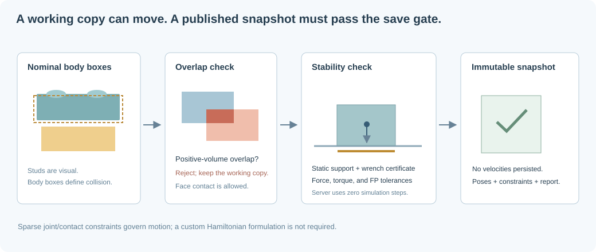

# Collision-aware static and dynamic rigid bodies

## The declared physical model

Each brick has a nominal body bounding box. Decorative studs are rendered but are
excluded from catalog body boxes: interlocking studs would otherwise look like
illegal penetration. A box is not a faithful collision shape for cavities,
Technic holes, clips, or bevels. The preferred basic-brick catalog keeps that
approximation manageable. Other geometry can be imported, but
publication requires operator-owned mass/nominal-bound records and applicable
connector measurements; a more detailed visual mesh does not make its box exact.

Dynamic colliders use nominal local body dimensions, transformed centres and the
actual metric-space orientation. They rotate with their bodies; a tilted plate
is not replaced by its larger world-axis bounding box. The box still approximates
hollow or bevelled geometry and is not exact mesh collision. Shields and spears
use reviewed compound face/handle and blade/shaft boxes. Reviewed circular
`4624c01`/`4624`/`3641` wheel/tyre datums use cylindrical dynamic colliders and
inertia when their nominal bounds match the sourced circular SI profile; tread,
interior cavities and rolling resistance are not resolved. Static compression
contacts require axis-aligned bearing faces; tilted pieces may instead transmit
their loads through joints, without treating an envelope face as bearing material.

Public coordinates are X east, Y north, Z up; gravity points along $-Z$.
Horizontal cells have $128\times128$ baseplates below the global Z=0 floor.
Vertical storage boundaries do not create extra floors. The kernel uses an
explicit east/up/south adapter internally; see [ground and coordinates](ground-and-coordinates.md).

## Broad phase and narrow phase

Testing all pairs costs $N(N-1)/2$. With one million bricks, that is about
$5\times10^{11}$ candidate pairs, before any actual collision calculation.

Broad-phase indexing rejects spatially separated pairs. Static imports use the
resident/world octree. The dynamic engine, Rapier, maintains its own broad and
narrow phases with temporal coherence.

For AABBs $A$ and $B$, define overlap along each axis:

$$
o_d=\min(A_{max,d},B_{max,d})-\max(A_{min,d},B_{min,d}).
$$

There is positive-volume penetration if $o_x,o_y,o_z>\epsilon$. Merely sharing a
face is allowed. The save gate uses a numerical tolerance of $10^{-4}$ brick
units; it does not intentionally permit visible overlap.

For rotated boxes, broad-phase AABBs are insufficient for exact box collision.
An OBB separating-axis test checks face normals of both boxes and cross-products
of their edge axes (up to 15 axes for orthogonal boxes). A convex narrow phase
such as GJK/EPA is another option. Rapier handles the dynamic analytic-box narrow
phase. Static/edit checks use the shared oriented-box SAT and finite registered
connector clearances after the octree's AABB broad phase.
Contact structures are initialized without advancing time. Using analytic cuboids
avoids degenerate zero-normal GJK contacts at exactly touching box faces in short
equilibrium probes.

## Rigid-body state and equations

Body $i$ has position $\mathbf{x}_i$, orientation $R_i$, linear/angular velocities
$\mathbf{v}_i,\boldsymbol\omega_i$, mass $m_i$, and inertia tensor $I_i$.
Ignoring constraints for a moment:

$$
m_i\dot{\mathbf{v}}_i=\mathbf{f}_i+m_i\mathbf{g},
$$

$$
I_i\dot{\boldsymbol\omega}_i+
\boldsymbol\omega_i\times(I_i\boldsymbol\omega_i)=\boldsymbol\tau_i.
$$

For a centered uniform-density box with full side lengths $a,b,c$:

$$
I_{body}=\frac{m}{12}\operatorname{diag}(b^2+c^2,a^2+c^2,a^2+b^2),
\qquad I_{world}=R I_{body}R^T.
$$

The solver uses SI dimensions, sourced per-part catalog masses, and gravity
9.80665 m/s². Inertia follows the nominal box/compound/cylinder approximation.
Friction is currently assumed;
connector capacities require operator-supplied measurements. These values are
not inferred from the visual mesh; see [physical calibration](physical-calibration.md).
The iterative solver can introduce significant error in tall unbonded stacks.
A failed dynamic run needs numerical-convergence checks before attributing its
motion to a real construction defect; changing a solver setting is not connector
calibration. Ground colliders and broken-joint removals use deterministic order
so a seeded probe does not inherit process-random hash iteration order.

## Why a sparse Hamiltonian model is not required

A Hamiltonian describes unconstrained conservative mechanics elegantly:

$$
H(\mathbf{q},\mathbf{p})=
\tfrac12\mathbf{p}^TM^{-1}\mathbf{p}+V(\mathbf{q}).
$$

But construction interaction also needs unilateral contact, friction,
nonpenetration, joint limits, damping, and eventually fracture. These are usually
handled more directly as constrained rigid-body dynamics. The important sparsity
is the **constraint graph and Jacobian**, not a specially invented Hamiltonian.

With velocity vector $\mathbf{v}$, constraint Jacobian $J$, impulse multipliers
$\boldsymbol\lambda$, and unconstrained velocity $\mathbf{v}^{*}$:

$$
\mathbf{v}^{+}=\mathbf{v}^{*}+M^{-1}J^T\boldsymbol\lambda,
$$

$$
(J M^{-1}J^T+\Gamma)\boldsymbol\lambda
=-(J\mathbf{v}^{*}+\mathbf{b}).
$$

$\mathbf{b}$ corrects drift and supplies desired motor velocity; $\Gamma$ can
represent compliance/regularization. Each ordinary joint or contact touches only
two bodies, so its Jacobian rows are sparse.

Contact is unilateral, not a plain unconstrained linear solve. At the position
level, the ideal normal conditions are:

$$
g_n\ge0,\qquad f_n\ge0,\qquad g_n f_n=0.
$$

Here $g_n$ is the signed gap and $f_n$ a compressive normal force. Friction adds a
cone such as $\|\mathbf{f}_t\|\le\mu f_n$. Sequential impulses/projected
Gauss–Seidel, as used in practical engines, iteratively solve this constrained
system without forming a dense global matrix. Solver iterations and stiffness
affect drift and apparent rigidity; they are not free accuracy.

## Connections are not the same as contact

- **Bounding-box contact candidate:** two nominal boxes share a face.
- **Inferred stud connection:** properly rotated, unscaled catalogue parts have
  coincident studs and receiving cavities, with compatible local stud directions.
- **Inferred mechanical connection:** source-datum grips/bars, pin/axle bores,
  wheel bearings and explicitly matched rim/tyre groups meet their geometric rules.
- **Explicit constraint:** an authored fixed or revolute relationship, stored by
  brick IDs with a world-space reference anchor.

Only inference supported by catalogue rules becomes an automatic connection.
Each registered connection has a bearing kind
([`Bearing`](../crates/world/src/attachments.rs)):

- **Free** revolute: frictionless `3673` pins, cross axles in round bores and wheel
  bearings. They turn freely apart from a small bearing friction.
- **Friction** revolute: friction pins (`2780` and every other pin in a round bore)
  and minifigure shoulder, wrist and hand-grip clips. They hold a pose until the
  load torque about the axis exceeds their friction torque.
- **Fixed**: keyed cross axles, rim/tyre fits and studs.
An AABB intersection alone must not magically glue arbitrary parts together.
The pavilion example uses a genuine cross-bonded plate deck and plate-supported
tree crowns. Connections are registered stud engagements, not imaginary
side-face welds.

## What “static before persistence” means

The server publishes a manifest only after validation. It does not trust the
browser's simulation result or an imported validation report.

1. Validate the catalog, schema, IDs, transforms, geometry bounds, and constraints.
2. Reject positive-volume body-box overlaps and baseplate intersections.
3. Add justified inferred stud joints, preserving explicit joints for the same
   pair of bricks. Give every joint its capacities from the server's measurement
   book, else from the reviewed connector estimates, else none (the joint may then
   carry no load), replacing untrusted client capacity claims.
4. Discover independent mechanical islands using every explicit/inferred joint,
   nominal bearing contact and reviewed stepped/compound bearing interface.
   Check each island separately: try constructive compression, then general
   equilibrium if needed, with independently verified reactions and joint loads.
5. Reject an uncertified result. The server does not run a time-integrated fallback;
   rendering and all dynamic tests execute in the browser/minimal WASM client.

An import may therefore exist as an unstable **working copy**, but cannot become
a published static snapshot until it passes this gate. A save stores poses and
constraints, not dynamic velocities.

See the [server validation source map](validation-gates.md) for the exact
pre-commit call chain and source locations of the overlap, connector, and gravity
checks. Inferred stud joints remain fixed even for a one-stud footprint;
automatic single-stud rotation is not implemented. Mechanical mating and free
axes follow the reviewed [connector definitions](part-catalog.md#hand-wheel-and-technic-attachments).

### Lightweight static certificate

The per-island execution and pending-load frontier below require v0.5.34 or later
with matching native/WASM bundles; an older service does not acquire them from
an MCP client upgrade alone.

The validation gate partitions the complete affected scene into independent
contact/joint islands using
[`validation_components.rs`](../crates/world/src/validation_components.rs).
Ground reactions do not join otherwise separate bodies, but a shared physical
support brick does. Storage cells, authoring groups and arbitrary geometric
chunks are never used as mechanical cuts. Reviewed 4444 wing/shelf bearings and
compound feet remain edges even outside a part's nominal mass envelope. All
joint edges are retained conservatively, including joints with no known capacity.

Each island is checked in sequence. When its constructive compression proof does
not suffice, [`equilibrium::certify`](../crates/world/src/equilibrium.rs) finds a
static equilibrium for that whole island as one sparse convex second-order cone
program solved by the pure-Rust Clarabel solver (the same code runs on the server
and in the WASM client). Load-sharing loops are never cut. Using sourced part masses and
box-center approximations, every body $i$ must balance its weight:

$$
\sum_k \mathbf{f}_k + m_i\mathbf{g} = 0,\qquad
\sum_k (\mathbf{r}_k-\mathbf{c}_i)\times\mathbf{f}_k + \sum_j \mathbf{M}_j = 0.
$$

The unknown reactions are:

- one wrench $(\mathbf{F}_j,\mathbf{M}_j)$ per joint, acting at its anchor (equal
  and opposite on its two bodies);
- nonnegative vertical forces at the corners of every horizontal contact patch
  between axis-aligned bodies, and at ground-contact corners (round tyres
  contribute their ground line below the axle);
- an unrestricted wrench on each anchored foundation brick.

Every joint load must stay inside its capacities. For a revolute joint with axis
$\mathbf{u}$:

$$
\|\mathbf{F}_j\|\le F_{cap},\quad
|\mathbf{u}\cdot\mathbf{F}_j|\le F_{axial},\quad
\|\mathbf{M}_j-(\mathbf{u}\cdot\mathbf{M}_j)\mathbf{u}\|\le M_{cap},\quad
|\mathbf{u}\cdot\mathbf{M}_j|\le T_{friction}.
$$

A fixed joint needs $\|\mathbf{F}_j\|\le F_{cap}$ and $\|\mathbf{M}_j\|\le M_{cap}$.
A joint without capacity carries no load. Unlike a spanning tree, load loops share
their loads: a chain hung between two supports, a pinned truss, or a minifigure
holding a spear with both hands. The objective minimises the sum of squared
utilisations, each load component against its own capacity, so a weak capacity
such as bearing friction is used only where equilibrium needs it.

The solution is then re-checked independently: body balance within the force and
moment tolerances (scaled to the current island's total weight) and every capacity within its own
tolerance. The report gives the maximum `max_joint_utilisation` over all islands,
`stability_components`, and `largest_equilibrium_component` (zero for a fully
compression-certified scene). Historical/unvalidated reports default the new
counts to zero, meaning unavailable. If no equilibrium exists, a
relaxed solve without capacity limits names the joints that would need more
capacity than measured or estimated, with the force and moment each would need.

For unanchored islands, a faster constructive path is tried first. It processes
bodies from top to bottom: each body's own gravity and loads received from above
are balanced by nonnegative barycentric reactions inside its horizontal support
patches, and loads pass to supporting bodies; grounded bodies balance their own
weight and every load received from above. Only the active frontier of pending
loads is retained: own weight is initialized lazily and a body's accumulated load
is removed when processed, preserving the original summation order. A tall single
column therefore needs only one pending-load entry, not one for every storey.
The result is a feasible point of the same equilibrium. The certificate is independent of piece ordering and needs no dynamic
simulation or guessed contact tension.
It can also certify studded assemblies by assigning zero wrench to every joint.
Reports mark this with `joint_strength_required:false`; no unmeasured clutch
capacity is used. When it fails, the general equilibrium above decides, with the
measured or reviewed capacities. Dynamic probes retain their
connector-calibration requirements.
When the constructive compression path fails, `compression_issue` identifies the
piece, its accumulated-load projection and bearing polygon. This explains the
failed sufficient certificate; it does not prove every possible load allocation
or calibrated joint model would fail.

This is component-wise solver execution and incremental load propagation, not
out-of-core validation: the caller still retains the affected bricks/joints, and
island discovery uses a resident spatial index and membership data linear in
the number of bodies and joints.
Only the current island's contacts, compression frontier and solver matrices are
built. `equilibrium::Problem.bricks` uses a borrowed `equilibrium::Bodies` view:
Rust callers use `Bodies::all(&bricks)` or `Bodies::select(&bricks, &indices)`;
partitioning does not clone brick geometry or renumber IDs. A single connected
castle may still be one large island. Island certificates
are aggregated only after all pass; none publishes a partial shared edit.

These are sufficient constructive certificates; an uncertified arrangement is
rejected. Mere graph reachability to the floor is not sufficient.

Contact-only static admission requires axis-aligned body faces (including rigid
quarter-turns). A tilted body's world AABB cannot establish a real bearing patch.
Tilted bodies must instead be above ground and have a registered joint-supported
load path that passes the equilibrium certificate and its capacity checks. Viewing and dynamic probing retain rigid tilted poses. Dynamic shapes use
nominal local dimensions and actual metric orientation, never the world AABB as
a replacement shape.

Catalogue stud volumes are also checked against neighbouring solid bodies.
Penetration is permitted only at a registered underside cavity with a compatible
orientation/lattice. A floor stud entering a sideways beam or stair support is
rejected even when the two nominal body boxes only touch.

### Numerical tolerances and short client probes

Defaults are $10^{-4}$ construction units for geometry, $10^{-4}$ radians for
reference-angle checks, $10^{-6}$ N force residual, and $10^{-8}$ N·m moment
residual. The server operator can set `ERGO_STATIC_POSITION_EPSILON`,
`ERGO_STATIC_ROTATION_EPSILON`, `ERGO_STATIC_FORCE_EPSILON_N`, and
`ERGO_STATIC_TORQUE_EPSILON_NM`. The report records the values; a client cannot
loosen the server's commit gate by choosing a generous local test tolerance.

The MCP gravity probe defaults to **one** actual step after zero-time contact
initialization. Step count (1–120), position tolerance, and rotation tolerance are
settable. Defaults are $10^{-3}$ construction units and $10^{-4}$ radians for the
probe's pose comparison. A short probe reports equilibrium within stated
floating-point/solver tolerances, not exact equality or indefinite robustness.
Earthquake and impact tests remain separate, longer, client-only load cases.
See [solidity tests](solidity-testing.md) and [solver references](references.md).

## Client connector failure

The snapshot stores connection identity separately from spatial contact. Optional
`break_force` thresholds allow a first breakable-joint experiment:

$$
F_{estimated}\approx\frac{\|\boldsymbol\lambda_{linear}\|}{\Delta t}.
$$

This is a timestep/solver-dependent impulse-derived estimate, not a calibrated
material stress. Force and torque thresholds are implemented.
For Rapier 0.26 joint impulses, $\Delta t$ is the solver substep interval
`dt / num_solver_iterations`; dividing by the full frame would understate a
steady joint load. CCD impact subdivision remains a separate qualification limit.

The force threshold is supplemented by an analogous torque threshold. A joint
with neither a measured nor an estimated capacity carries no load in the static
certificate. A zero-joint-wrench compression proof does not establish clutch
strength or dynamic robustness.

### Friction joints and settling

A friction revolute joint carries a Rapier velocity motor with target velocity 0
and a maximum torque equal to its friction torque: it holds until the load torque
exceeds that friction, then slips. Free bearings carry the same motor with their
small bearing friction.

`simulate_gravity` ([`articulation::settle`](../crates/world/src/articulation.rs))
lets gravity act for at most 8 s with strong velocity damping (5 s⁻¹) and no
sleeping. Damping removes energy without moving the rest pose. It stops once
every body has moved slower than about 14 µm/s (kinetic energy below
$10^{-10}\,\text{J/kg}$ of dynamic mass) for 0.5 s. A square piece resting on
the floor that moved only by contact-solver jitter (at most 0.5 mm and 0.5°)
keeps its exact pose.

Every connection is then projected back onto its exact registered geometry
(`project_joints`: position-based coaxial and rigid links, with anchored and
floor-resting pieces held). Joints are re-inferred from that geometry rather than
copied from the simulation, and the kept pose is validated like any edit. A free
Technic chain hung between two supports therefore settles into its funicular
shape and becomes publishable; an unbalanced chain on friction pins already
holds.

Destruction occurs in the transient sandbox. The result can be saved only after
it has settled, is overlap-free, and passes the same server-side validation gate.
