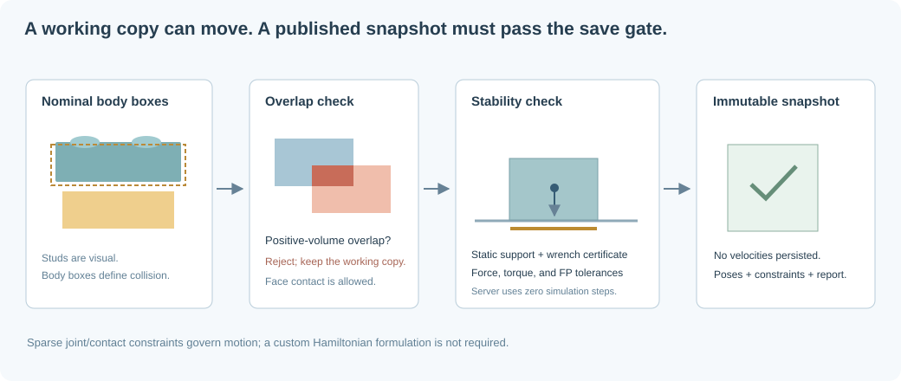

# Collision-aware static and dynamic rigid bodies

## The declared physical model

Each brick has a nominal body bounding box. Decorative studs are rendered but are
excluded from catalog body boxes: interlocking studs would otherwise look like
illegal penetration. A box is not a faithful collision shape for cavities,
Technic holes, clips, or bevels. The preferred basic-brick catalog keeps that
approximation manageable. Other Studio/LDraw geometry can be imported, but
publication requires operator-owned mass/nominal-bound records and applicable
connector measurements; a more detailed visual mesh does not make its box exact.

Initial world-axis body AABBs become analytic cuboid colliders. During simulation they
rotate with their bodies. Thus imported rotations may have conservative initial
boxes, and false collisions are possible. This is an intentional approximation,
not exact mesh collision.

Public coordinates are X east, Y north, Z up; gravity points along $-Z$.
Horizontal cells have $1024\times1024$ baseplates below the global Z=0 floor.
Vertical storage boundaries do not create extra floors. The kernel uses an
explicit east/up/south adapter internally; see [ground and coordinates](ground-and-coordinates.md).

## Broad phase and narrow phase

Testing all pairs costs $N(N-1)/2$. With one million bricks, that is about
$5\times10^{11}$ candidate pairs, before any actual collision calculation.

Broad-phase indexing rejects spatially separated pairs. Static imports use the
resident/world octree. The dynamic engine, Rapier, maintains its own broad and
narrow phases with temporal coherence. Suitable future alternatives include a
dynamic AABB tree, sweep-and-prune, or a spatial hash for fairly uniform bricks.

For AABBs $A$ and $B$, define overlap along each axis:

$$
o_d=\min(A_{max,d},B_{max,d})-\max(A_{min,d},B_{min,d}).
$$

There is positive-volume penetration if $o_x,o_y,o_z>\epsilon$. Merely sharing a
face is allowed. The save gate uses a numerical tolerance of $10^{-4}$ brick
units; it does not intentionally permit visible overlap.

For rotated boxes, broad-phase AABBs are insufficient for exact box collision.
An OBB separating-axis test checks face normals of both boxes and cross-products
of their edge axes (up to 15 axes for orthogonal boxes). A convex narrow phase
such as GJK/EPA is another option. Rapier handles the dynamic analytic-box narrow
phase. The editor's translation preflight deliberately uses conservative AABBs.
Contact structures are initialized without advancing time. Using analytic cuboids
avoids degenerate zero-normal GJK contacts at exactly touching box faces in short
equilibrium probes.

## Rigid-body state and equations

Body $i$ has position $\mathbf{x}_i$, orientation $R_i$, linear/angular velocities
$\mathbf{v}_i,\boldsymbol\omega_i$, mass $m_i$, and inertia tensor $I_i$.
Ignoring constraints for a moment:

$$
m_i\dot{\mathbf{v}}_i=\mathbf{f}_i+m_i\mathbf{g},
$$

$$
I_i\dot{\boldsymbol\omega}_i+
\boldsymbol\omega_i\times(I_i\boldsymbol\omega_i)=\boldsymbol\tau_i.
$$

For a centered uniform-density box with full side lengths $a,b,c$:

$$
I_{body}=\frac{m}{12}\operatorname{diag}(b^2+c^2,a^2+c^2,a^2+b^2),
\qquad I_{world}=R I_{body}R^T.
$$

The solver uses SI dimensions, sourced per-part catalog masses, and gravity
9.80665 m/s². Inertia remains a box approximation. Friction is currently assumed;
connector capacities require operator-supplied measurements. These values are
not inferred from the visual mesh; see [physical calibration](physical-calibration.md).

## Why a sparse Hamiltonian model is not required

A Hamiltonian describes unconstrained conservative mechanics elegantly:

$$
H(\mathbf{q},\mathbf{p})=
\tfrac12\mathbf{p}^TM^{-1}\mathbf{p}+V(\mathbf{q}).
$$

But construction interaction also needs unilateral contact, friction,
nonpenetration, joint limits, damping, and eventually fracture. These are usually
handled more directly as constrained rigid-body dynamics. The important sparsity
is the **constraint graph and Jacobian**, not a specially invented Hamiltonian.

With velocity vector $\mathbf{v}$, constraint Jacobian $J$, impulse multipliers
$\boldsymbol\lambda$, and unconstrained velocity $\mathbf{v}^{*}$:

$$
\mathbf{v}^{+}=\mathbf{v}^{*}+M^{-1}J^T\boldsymbol\lambda,
$$

$$
(J M^{-1}J^T+\Gamma)\boldsymbol\lambda
=-(J\mathbf{v}^{*}+\mathbf{b}).
$$

$\mathbf{b}$ corrects drift and supplies desired motor velocity; $\Gamma$ can
represent compliance/regularization. Each ordinary joint or contact touches only
two bodies, so its Jacobian rows are sparse.

Contact is unilateral, not a plain unconstrained linear solve. At the position
level, the ideal normal conditions are:

$$
g_n\ge0,\qquad f_n\ge0,\qquad g_n f_n=0.
$$

Here $g_n$ is the signed gap and $f_n$ a compressive normal force. Friction adds a
cone such as $\|\mathbf{f}_t\|\le\mu f_n$. Sequential impulses/projected
Gauss–Seidel, as used in practical engines, iteratively solve this constrained
system without forming a dense global matrix. Solver iterations and stiffness
affect drift and apparent rigidity; they are not free accuracy.

## Connections are not the same as contact

- **Bounding-box contact candidate:** two nominal boxes share a face.
- **Inferred stud connection:** upright, unscaled catalog parts have coincident
  stud lattices and a matching top/bottom contact, with studs on the lower part.
- **Explicit constraint:** an authored fixed or revolute relationship, stored by
  brick IDs with a world-space reference anchor.

Only inference supported by catalog rules becomes an automatic fixed connection.
An AABB intersection alone must not magically glue arbitrary parts together.
The pavilion example additionally has authored fixed bonds on touching faces so
its architectural slabs behave as rigid assembled elements.

## What “static before persistence” means

The server publishes a manifest only after validation. It does not trust the
browser's simulation result or an imported validation report.

1. Validate the catalog, schema, IDs, transforms, geometry bounds, and constraints.
2. Reject positive-volume body-box overlaps and baseplate intersections.
3. Add justified inferred stud joints, preserving explicit joints for the same
   pair of bricks.
   For ordinary publication, require matching server-owned measured connector
   force/torque capacities and replace untrusted client capacity claims.
4. Construct a conservative support/constraint-wrench certificate with nonnegative
   ground reactions, admissible contacts, and force/torque capacity checks.
5. Reject an uncertified result. The server does not run a time-integrated fallback;
   rendering and all dynamic tests execute in the browser/minimal WASM client.

An import may therefore exist as an unstable **working copy**, but cannot become
a published static snapshot until it passes this gate. A save stores poses and
constraints, not dynamic velocities.

See the [server validation source map](validation-gates.md) for the exact
pre-commit call chain and source locations of the overlap, connector, and gravity
checks. In particular, inferred stud joints are currently fixed even for a
one-stud footprint; automatic single-stud rotation and connector-specific mating
validation are not implemented. Generic authored revolute constraints are supported.

### Lightweight static certificate

The graph includes explicit/inferred joints and vertical face-contact candidates.
A forest is selected globally with joint edges before unilateral contact edges.
Using sourced part masses and box-center approximations, compute each component's
center of mass:

$$
\mathbf{c}=\frac{\sum_i m_i\mathbf{c}_i}{\sum_i m_i}.
$$

Collect all direct horizontal baseplate-contact patches and take the convex hull
$P$ of their XY corners. Under downward gravity alone, a component has an
admissible vertical support-force distribution if:

$$
\operatorname{proj}_{XY}(\mathbf{c})\in P.
$$

Ground reactions are distributed at support-hull vertices using nonnegative
barycentric weights. For each selected tree edge, sum external forces and moments
on its subtree. The edge must supply the opposing wrench:

$$
\mathbf{F}_e=-\sum_{i\in S_e}\mathbf{f}_i,\qquad
\boldsymbol\tau_e=-\sum_{i\in S_e}(\mathbf{r}_i-\mathbf{a}_e)\times\mathbf{f}_i.
$$

Fixed joints must remain within their measured force/torque envelopes; a revolute
joint additionally cannot supply torque about its free axis. Unilateral contacts
must be compressive and have their center of pressure inside the shared patch.
Grounded authored fixtures can supply a foundation reaction. Residual wrench must
be within the configured numerical tolerances.

This is a constructive sufficient certificate, not a search over every possible
reaction distribution. A safe configuration may be conservatively rejected when
this particular forest/distribution cannot certify it. Mere graph reachability
to the floor is not sufficient. The general sparse feasibility extension is:

$$
A\mathbf{f}+\mathbf{w}=0,
\qquad \mathbf{f}\in\mathcal{K}_{contact},
\qquad \mathbf{f}_{joint}\in\mathcal{K}_{capacity}.
$$

That general optimization is proposed; the implemented gate uses the lightweight
constructive certificate and does not depend on the dynamics engine.

### Numerical tolerances and short client probes

Defaults are $10^{-4}$ construction units for geometry, $10^{-4}$ radians for
reference-angle checks, $10^{-6}$ N force residual, and $10^{-8}$ N·m moment
residual. The server operator can set `ERGO_STATIC_POSITION_EPSILON`,
`ERGO_STATIC_ROTATION_EPSILON`, `ERGO_STATIC_FORCE_EPSILON_N`, and
`ERGO_STATIC_TORQUE_EPSILON_NM`. The report records the values; a client cannot
loosen the server's commit gate by choosing a generous local test tolerance.

The MCP gravity probe defaults to **one** actual step after zero-time contact
initialization. Step count (1–120), position tolerance, and rotation tolerance are
settable. Defaults are $10^{-3}$ construction units and $10^{-4}$ radians for the
probe's pose comparison. A short probe reports equilibrium within stated
floating-point/solver tolerances, not exact equality or indefinite robustness.
Earthquake and impact tests remain separate, longer, client-only load cases.
See [solidity tests](solidity-testing.md) and [P1–P4](references.md).

## Scaling physics beyond the initial sandbox

Display residency is not a valid physics domain: removing an offscreen supporting
brick can create a false collapse. The initial sandbox loads the complete
construction and freezes its streaming set. Large-world simulation needs:

- Mechanical-island discovery using joint edges and relevant contact dependencies.
- Explicit fixed boundary bodies or complete halo supports at the domain boundary.
- Sleeping stable islands and waking only edited or impacted regions.
- Collapsing unbreakable fixed components into compound rigid bodies.
- A multi-level broad phase: region, island, body, then shape.
- Worker execution and bounded communication of changed poses to the renderer.

Do not weld together a revolute mechanism. Also, sleeping is a performance state,
not evidence that an imported construction is stable.

## Future real-time dynamic destruction

The snapshot stores connection identity separately from spatial contact. Optional
`break_force` thresholds allow a first breakable-joint experiment:

$$
F_{estimated}\approx\frac{\|\boldsymbol\lambda_{linear}\|}{\Delta t}.
$$

This is a timestep/solver-dependent impulse-derived estimate, not a calibrated
material stress. Force and torque thresholds are implemented; future models need directional envelopes, accumulated damage,
fatigue/energy, and connector-specific failure modes.

When a bond breaks, remove its graph edge, recompute affected rigid components,
split compound colliders if necessary, and conserve component linear/angular
momentum. Wake newly detached components and let contacts plus gravity determine
their motion. A simple union-find supports merging but cannot delete an edge;
use an affected-component traversal or a dynamic-connectivity structure for
fracture.

The force threshold is supplemented by an analogous torque threshold. Missing
capacity data is disclosed in a local sandbox and blocks ordinary publication.

Destruction occurs in the transient sandbox. The result can be saved only after
it has settled, is overlap-free, and passes the same server-side validation gate.
