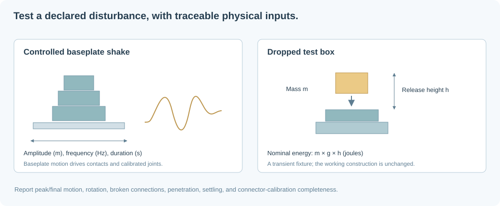

# Solidity tests: earthquake and falling object

## Purpose and interpretation

A static gravity check asks whether the construction remains at rest under its
own weight. A solidity test asks what happens under a **specified disturbance**.
Ergo supports two reproducible, non-destructive test cases in the web UI and the
MCP `test_solidity` tool:

- Horizontal baseplate shaking with an explicit displacement waveform.
- A box dropped from a specified reference height with specified mass/dimensions.



A result applies to the chosen waveform or impact only. Missing connector
capacities are reported, not replaced with invented real-world strengths. Nominal
metric dimensions and sourced part masses are always separate from GPS cell
addressing. See [physical calibration](physical-calibration.md).

## Earthquake / baseplate-shake model

The initial case is a controlled horizontal shake, not a claim to reproduce a
particular recorded earthquake. The inputs are amplitude $A$ in meters, frequency
$f$ in Hz, duration $T$ in seconds, and a horizontal unit direction $\mathbf{u}$.
For $0<t<T$:

$$
\mathbf{d}(t)=\mathbf{u}\,A\sin(2\pi f t)\sin^2\left(\frac{\pi t}{T}\right).
$$

Outside the interval, displacement is zero. The sine-squared envelope makes both
displacement and velocity start/end at zero, avoiding an artificial instantaneous
baseplate teleport. The engine moves kinematic baseplates and explicitly anchored
ground fixtures; dynamic bricks respond through contact friction and joints.

The amplitude is **displacement**, not acceleration or earthquake magnitude.
Writing $\omega=2\pi f$ and $k=\pi/T$, an upper bound on acceleration magnitude is:

$$
\|\ddot{\mathbf{d}}(t)\|
\le A(\omega^2+2\omega k+2k^2).
$$

The reported bound includes envelope derivatives. Reporting only $A\omega^2$
would omit those terms. For example, $A=0.002$ m, $f=5$ Hz, and $T=2$ s yield an
upper bound of approximately $2.18$ m/s², about $0.223g$. This is a bound, not
necessarily the exact peak of the waveform.

The simulator runs the shake followed by two seconds of unforced settling. It
does not pin all baseplate-touching bricks: only explicitly authored ground
fixtures are anchored. Other bricks may slide, rock, or detach.

The current waveform permits amplitudes 0–50 mm, frequencies 0.1–20 Hz, and
durations 0.1–4 s. At 120 Hz physics stepping, the highest frequency is represented
by relatively few samples per cycle. Use convergence studies and smaller steps
before treating high-frequency results as quantitatively reliable.

## Falling-object model

Inputs are the dropped object's mass $m$ in kg, box side lengths in meters,
construction-space target/reference coordinates, and vertical release offset
$h$ in meters. The object starts with zero velocity; gravity accelerates it and
continuous collision detection reduces tunneling at impact.

Relative to the supplied reference plane, the initial potential energy is:

$$
E_p=mgh.
$$

Ignoring drag and assuming a fall through distance $h$ before contact:

$$
v_{impact}\approx\sqrt{2gh}.
$$

For a 50 g object and 100 mm release offset, $E_p\approx0.0490$ J. Actual contact
can occur earlier because the object has finite height or because another part
stands above the reference. The energy report is the nominal reference energy,
not a measured energy fully transferred to the construction.

Peak contact force is not determined by $mgh$ alone: contact duration, stiffness,
restitution, material response, and the impulse solver all matter. A box impact
with rigid contacts cannot predict local ABS crushing or detailed stress waves.
The current test is for movement, contact response, and connector failure under
the declared approximation.

The current limits are 0.1 g–10 kg mass, 1 mm–1 m box side lengths, and 1 cm–2 m
release offset. The simulation runs for four seconds. The dropped box is a
transient test fixture and is not added to the saved construction or working
copy. The UI drops above the selected brick's X/Y position, or the model center,
using the model's top as its reference height.

## Reported results

The test reports:

- Peak displacement in meters sampled at every physics step.
- Final maximum displacement in construction units and orientation change in degrees.
- Broken connection count, deep penetration count, and remaining motion.
- Whether all joints have force/torque thresholds and source information.
- The shake acceleration bound or nominal dropped-object potential energy.
- Model limitations and the exact load-case parameters.

“Survived the declared case” currently means no broken connections, final position
drift under 0.1 construction units, final rotation under 1°, no deep penetration,
and sufficiently small residual motion after settling. These thresholds are
acceptance criteria, not a calibrated building-code standard. Peak transient
movement is reported separately and may be larger than final drift.

## Web and MCP workflows

`test_stability_by_gravity` supplies a non-destructive short equilibrium probe.
It defaults to **one** actual physics step; `steps` is settable from 1 to 120.
Contact structures are initialized without advancing time first. Pose comparisons
use explicit floating-point/solver tolerances, not exact equality. Defaults are
`position_tolerance: 0.001` construction units and
`rotation_tolerance_radians: 0.0001`.

```json
{"steps": 1, "position_tolerance": 0.001, "rotation_tolerance_radians": 0.0001}
```

The result includes the local static certificate, pose changes, velocity/breakage
diagnostics, and calibration completeness. It does not require many settling
steps or treat one step as proof against later disturbances. The deployed server
uses its own numerical tolerances and a **zero-step** static commit certificate;
local settings cannot override it.

`test_stability_by_earthquake` accepts a given local shaking intensity:

```json
{
  "peak_ground_acceleration_g": 0.2,
  "frequency_hz": 4,
  "duration_s": 3,
  "include_images": true
}
```

Displacement is derived from the same analytic acceleration bound used below.
Separate X/Y horizontal cases start from the same original model. The input is not a
Richter/moment magnitude. Converting a source earthquake magnitude into local
motion is not a supported input: current load cases take explicit local motion/PGA.

`test_visual_appearance` renders from an arbitrary camera or preset directions;
see [the MCP document](local-construction-mcp.md) for camera arguments.

### Dedicated moderate-earthquake MCP tool

Call `test_moderate_earthquake_stability` with:

```json
{"include_images": true}
```

The named `ergo-moderate-shake-v2` preset runs the original construction
independently in X and Y. Each case is 3 s of shaking at 4 Hz and 2 s of settling.
Displacement amplitude is selected so the analytic acceleration upper bound is
exactly $0.15g$:

$$
A=\frac{0.15g}{\omega^2+2\omega k+2k^2},\qquad
\omega=2\pi\cdot4,\quad k=\pi/3.
$$

The result distinguishes `survived_both_declared_cases` from
`calibrated_stability_verified_for_preset`. The latter requires complete measured
connector capacities as well as survival. Unknown capacities never become a
verified physical pass. Optional images show the post-test construction for each
axis; the original working copy is unchanged.

“Moderate” is a project test-profile name. It does not assign a Richter/moment
magnitude, Mercalli intensity, local hazard class, or seismic-code compliance.

### Custom load cases

In the web workbench, choose **Test solidity…** in the physics panel. Set the
earthquake or dropped-box parameters and run the test. The complete construction
must be loaded; a camera-clipped fragment cannot establish support behavior.
The report does not replace the currently edited poses.

Example MCP earthquake arguments:

```json
{
  "load_case": {
    "kind": "earthquake",
    "displacement_amplitude_m": 0.002,
    "frequency_hz": 5,
    "duration_s": 2,
    "direction": [1, 0, 0]
  },
  "include_image": true
}
```

Example falling-object arguments:

```json
{
  "load_case": {
    "kind": "falling_object",
    "mass_kg": 0.05,
    "dimensions_m": [0.01, 0.01, 0.01],
    "target_world": [6, 5, 6],
    "release_height_m": 0.1
  },
  "include_image": true
}
```

The MCP result includes an optional isometric PNG of the post-test construction.
The original local working copy remains unchanged. Vision feedback complements
the structured displacement/breakage results; a visually intact model may still
contain overstressed or uncalibrated connections.
